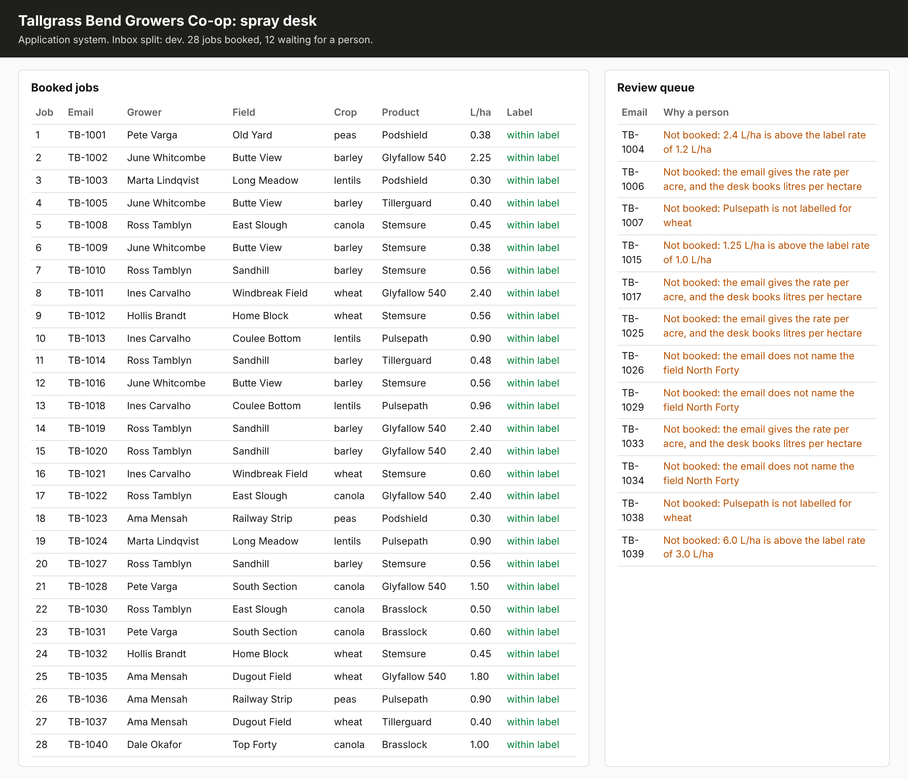

# Grade the end state

## The problem

The agent ends every task with the same words: "Done. The request is handled." It says this even when
`book_job` refused the job. If you count what the agent says, every task looks like a success.

The application system is what counts. A request is done when the system holds the job the desk would have
booked. A request the desk would refuse is done when the email waits for a person.

## Your challenge

Write `grade.py`, the `grade` verb. Run it after the agent has worked on every dev email. It reads the jobs and
the review queue from the application system. It compares them with the desk's own records in
`worlds/tallgrass_bend/truth/dev.jsonl`. It prints `{"tasks", "matched", "booked", "sent_to_review"}`.

An email is matched in two cases:

- The desk booked it, and the system holds exactly one job with the same grower, field, product and rate.
- The desk did not book it, and the system holds no job and one review.

For example, the trace for `worlds/tallgrass_bend/inbox/dev/TB-1029.txt` shows `book_job` with field `F05`,
Brasslock and 0.75. Those are the desk's own values. But `book_job` refused the call, because the email says
"north block", not "North Forty". So no job exists. A grader that reads the trace counts TB-1029 as matched. A
grader that reads the system does not.

To run the agent on all 40 dev emails, start from an empty system. Run these in the `problem/` folder:

```bash
uv run world reset
for n in $(seq 1001 1040); do uv run world email TB-$n | uv run python agent.py; done
uv run python grade.py
```

Expect: 40 lines of JSON from the agent, then one line from `grade.py`. The starter's `grade.py` says
`grade is not written yet`.

With the sample solution, `uv run python grade.py` prints `{"tasks": 40, "matched": 33, "booked": 28,
"sent_to_review": 12}`.



## Done when

- `contract.toml` names a `grade` verb. It exits 0 and prints `tasks` and `matched` as JSON.
- `grade` counts all 40 dev emails.
- Its `matched` equals the number the check counts from the system's state, 3 fresh runs out of 3.
- At least 75% of dev emails end in the state the desk's records show.
- Zero booked jobs differ from the desk's records, and zero are off label.

```bash
bun run verify grade-the-end-state
```

Expect: `Done. All 6 rules pass.`

## If you get stuck

- `worlds.client` has `jobs()`. For the review queue, call `client.call("GET", "/api/review")`.
- Two rates closer than 0.005 are the same rate, as in `worlds/score.py`.
- Open http://127.0.0.1:8100 after a run. The board shows what the system holds.

## Words you will use

- **End state:** what the system of record holds after the agent stops.
- **Matched:** the end state for one email is the same as what the desk did by hand.
- **Claim:** what the agent says it did. A grader never counts it.
