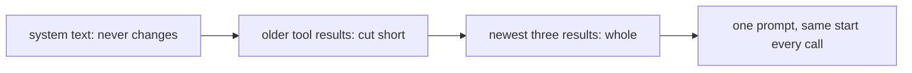

# Trim and cache the context

## The problem

Each model call sends the whole run again. By the tenth tool call the prompt holds ten long records, and you
pay for all of them each time. Two fixes help. Shorten old tool results, because the model no longer needs
them in full. And keep the start of the prompt exactly the same on every call, because providers charge much
less for a start they have already seen. This keeps the start the same, so a provider can cache it. For example, tool result 1 is a long record of 360 words. By call ten you have paid for it ten times, and it is cut to a short line.

## Your challenge

Open `context.py`. The function `build_prompt` puts the clock into the system message, so no two prompts
start the same, and it keeps every record whole. Fix both:

1. Send the system text as it is. Put no clock, no random id and no date in it.
2. Keep the three newest tool results whole.
3. Cut each older tool result to its first 80 letters, followed by `[trimmed]`.
4. Keep every user and assistant message, in order.

```bash
cd parts/05-let-it-act/04-trim-and-cache-the-context/problem
python3 -c "from context import build_prompt as b; print(b('Be brief.', [{'role': 'user', 'content': 'hi'}])[0]['content'])"
```

Expect: `Be brief.` once you finish. The starter prints the text with a `Now:` line under it.



## Do it on your work

Open one real run's log from your own agent. Count the words in the longest tool result. Then run your
prompt builder on that run. Good looks like this: the prompt is at least a third smaller, and the first
message is byte for byte the same on every call.

## Done when

- The same input gives the same prompt twice, so nothing like a clock is in it.
- The system message comes first and is exactly your system text.
- Tool results older than the newest three are cut short. The newest three are whole.
- A run with ten tool calls sends far fewer words than the full history.
- Every user and assistant message is still there, in order.

```bash
bun run verify trim-and-cache-the-context
```

Expect: `Done. All 5 rules pass.`

## If you get stuck

- Find the tool messages first: `[i for i, m in enumerate(history) if m["role"] == "tool"]`.
- `positions[:-3]` is every position except the last three.
- A date in the system text is fine if it changes once a day, but it breaks the cache at midnight. Put it in the first user message.

## Words you will use

- **Context:** everything you send to the model in one call.
- **Steady start:** a prompt that begins the same way each call, so a provider is able to reuse it and charge less.
- **Prefix:** the first part of the prompt.
