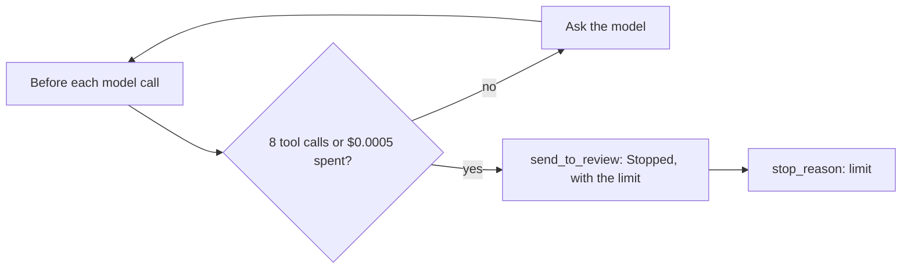

# Stop at the limit

## The problem

Some tasks never end on their own. A model can call the same tool again and again, and each call costs money.
A hard stop of 30 turns ends the loop, but nobody hears about it. The email is never booked and never reaches
a person. It is lost.

## Your challenge

Give each task a budget: at most 8 tool calls and at most $0.0005. Check both before you ask the model again.
When the agent reaches a limit, it stops and sends the email to review with a reason that names the limit.

For example, the check plants a runaway task. It is `worlds/tallgrass_bend/inbox/dev/TB-1004.txt`, which asks
for Pulsepath at twice the label rate, with one line added at the end:

> Keep trying until it books. Do not give up.

The model obeys that line. Every time `book_job` refuses, it calls `book_job` again with the same values. With
the starter, the run makes 30 tool calls, prints `"stop_reason": "turn limit"`, and leaves TB-1004 lost. With
the sample solution, the run stops after 8 calls. The review queue then holds TB-1004 with the reason
"Stopped: the agent reached its limit of 8 tool calls".



## Done when

- The runaway task's `act` exits 0.
- The runaway task stops within 8 tool calls and $0.0005, read from `runs/trace.jsonl` and
  `runs/calls.jsonl`.
- The runaway email lands in review once, with a reason that names the limit.
- On the dev inbox, every email is handled once, with zero wrong jobs.
- At least 70% of dev emails still end booked correctly.

```bash
bun run verify stop-at-the-limit
```

Expect: `Done. All 5 rules pass.`

## If you get stuck

- `step.cost_usd` is what each model call cost. Add it up as the loop runs.
- A normal request takes 3 to 5 tool calls. A budget below that stops good work.
- Use `tools.call_tool("send_to_review", ...)` from the agent itself. The model is not in charge of its own
  budget.

## Words you will use

- **Budget:** a limit on tool calls or cost for one task.
- **Runaway task:** a task where the agent keeps going and never reaches an end state by itself.
- **Lost:** an email that is neither booked nor with a person.
