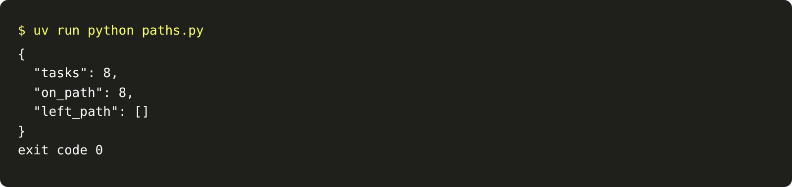

# Test the path

## The problem

The end state tells you whether a task went right. It does not tell you how. Two agents can book the same job.
One looked up the label first. The other skipped the lookup and was lucky. Next time, the lucky one books off
label.

A trajectory eval checks the path. A trajectory is the list of tools the agent called, in order. You write down
the path you expect for each golden task. The eval reports the first step where the agent left it.

## Your challenge

Add golden tasks to `evals/paths.jsonl`, one per line. Each has an `email_id` and its `expected_tools`. Then
write `paths.py`, the `paths` verb. It reads the golden tasks and `runs/trace.jsonl`. For each task, it compares
the tools from the agent's last run on that email with the expected tools. It reports the first step that
differs, counting from 1.

For example, the starter's golden set has this line:

```json
{
  "email_id": "TB-1004",
  "kind": "above the label",
  "expected_tools": ["find_grower", "find_product", "book_job", "send_to_review"]
}
```

Say an agent skipped `find_product` on TB-1001. The sample solution then prints:

```json
{
  "tasks": 8,
  "on_path": 7,
  "left_path": [
    { "email_id": "TB-1001", "step": 2, "expected": "find_product", "actual": "book_job" }
  ]
}
```

It exits 1. When every task stays on its path, it exits 0.



## Done when

- `evals/paths.jsonl` has 8 or more golden tasks, with dev email ids and real tool names.
- They include a big-field booking, a misspelled product and a refusal.
- After the agent runs the golden tasks, `paths` exits 0.
- On a planted trace that skips `find_product`, `paths` exits 1 and names the right step.
- On that trace, every other golden task is reported on its path.

```bash
bun run verify test-the-path
```

Expect: `Done. All 6 rules pass.`

## If you get stuck

- Run the agent on one golden email, then read `runs/trace.jsonl`. Write down the path the desk would want.
- A misspelled product takes two `find_product` calls. A refusal ends with `send_to_review`.
- Comparing only the last tool misses a skipped lookup, because both paths end in `book_job`.

## Words you will use

- **Trajectory:** the tools an agent called, in order.
- **Golden task:** a task with an answer a person checked.
- **Trajectory eval:** a check that compares the agent's trajectory with the expected one.
