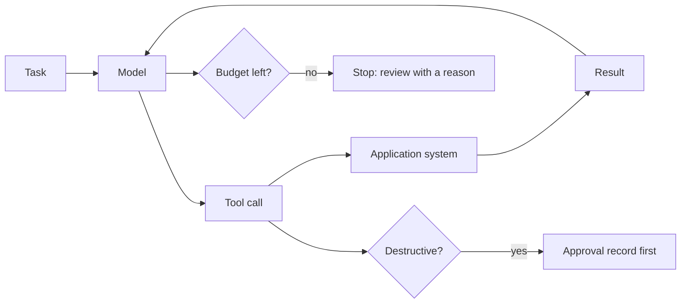

# Let it act

## The problem

The desk still books the sprayer crews by phone. Someone has to decide which crew goes, to which field, and
after which job. An agent can do this work. An agent is a model that calls tools in a loop until a task is
done. It can read the request, check the label, look at the crews' plans and book through the application
system's tools.

But an agent can also say "booked" when nothing changed in the system. That is worse than no agent at all. So
the check never trusts what the agent says. It reads the system.

For example, an agent works on `worlds/tallgrass_bend/inbox/dev/TB-1001.txt` and could reply "Booked Podshield on
Old Yard". The check then asks the application system for the jobs. If there is no job for TB-1001 with field
`F14`, product `P150` and rate 0.38, the task failed, whatever the agent said.

## Why it matters

The way you write a tool decides how well an agent uses it. Anthropic rewrote the description of one tool.
They report that it "resulted in a 40% decrease in task completion time". That is for "future agents using the
new description"
([Anthropic, How we built our multi-agent research system](https://www.anthropic.com/engineering/multi-agent-research-system)).
Their guide also says to grade what the agent produced in the system. Do not grade what it says it did.

## What you build



A tool is a function the agent can call, such as one that books a job. A destructive tool changes or deletes
data that you cannot easily get back. A budget is a limit on steps or cost, so a runaway agent stops.

## The labs

- Core: [Design Tools for AI Agents with MCP](https://github.com/learnwithparam/live-labs/tree/main/labs/12-mcp-tools) (live-labs `labs/12-mcp-tools`, about 20 minutes)
- Core: [Authorize AI Agent Actions with RBAC and ABAC](https://github.com/learnwithparam/live-labs/tree/main/labs/22-agent-actions-authz) (live-labs `labs/22-agent-actions-authz`, about 20 minutes)
- Optional: [Cut Agent Token Costs with Context Engineering](https://github.com/learnwithparam/live-labs/tree/main/labs/13-context-engineering), [Add Long-Term Memory to AI Agents with Mem0](https://github.com/learnwithparam/live-labs/tree/main/labs/14-agent-memory), [Build a Deep Research Agent with Subagents](https://github.com/learnwithparam/live-labs/tree/main/labs/15-research-subagents), [Ship a Remote MCP Server with OAuth](https://github.com/learnwithparam/live-labs/tree/main/labs/20-remote-mcp-oauth)

## Steps

| Step                  | Minutes | You produce                                    | Done when (what the check reads)                                                                              |
| --------------------- | ------- | ---------------------------------------------- | ------------------------------------------------------------------------------------------------------------- |
| `write-the-tools`     | 20      | An MCP server over the world with 3 to 6 tools | A test client lists the tools; each has a description and typed input                                         |
| `explain-the-errors`  | 20      | Tool errors an agent can act on                | A bad argument returns a message that says what to do next, never a stack trace                               |
| `run-the-loop`        | 20      | An `act` verb                                  | The agent runs every dev task to an end state without crashing                                                |
| `grade-the-end-state` | 20      | End-state grading                              | The world's state after each run equals the expected state for the target share; the agent's claim is ignored |
| `stop-at-the-limit`   | 20      | Step and cost budgets                          | The planted runaway task stops within budget and lands in review with a reason                                |
| `ask-before-acting`   | 30      | An approval gate on destructive tools          | Zero destructive calls without an approval record across dev and 5 planted tasks                              |
| `test-the-path`       | 30      | A trajectory eval                              | Each golden task lists the expected tool order; the eval reports where the agent left it                      |
| `prove-the-agent`     | 20      | Scorecard line 5                               | Test tasks reach the target, zero unapproved destructive calls, lines 1 to 4 pass                             |

The steps take 180 minutes in total. The brief planned `write-the-tools` and `run-the-loop` as 40 minutes
each. Here, each one is split into two steps. Calder Fen Electric Co-op (`worlds/README.md`) is the project
brief that matches this part. The live-labs lab `labs/11-agent-loop` needs to be rebuilt. It is not a lesson
until then.

## Walkthrough

TODO(part session): the commands for each step, each with an `Expect:` line. The steps above are planned.
They have no folders yet, so this part has nothing to check:

```bash
bun run verify part let-it-act
```

Expect: `Part let-it-act is done: 0/0 steps pass.`
