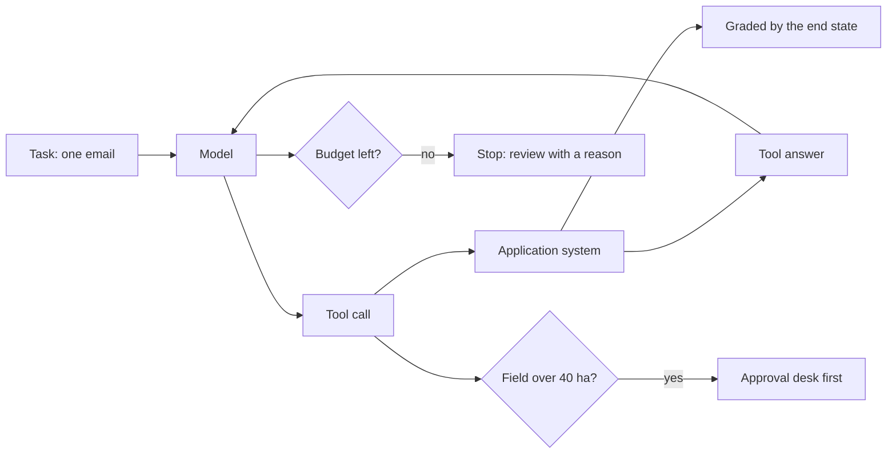

# Let it act

## The problem

In the "Get records you can trust" part, your code read each email and booked it. Every step was fixed in advance. Now the desk wants an
agent. An agent is a model that calls tools in a loop until a task is done. It looks up the grower, looks up
the product, and books the job through the application system's tools.

But an agent can say "booked" when nothing changed in the system. That is worse than no agent at all. So the
checks in this part never trust what the agent says. They read the system.

For example, an agent works on `worlds/tallgrass_bend/inbox/dev/TB-1004.txt` and ends with "Done. The request
is handled." The check then asks the application system for its jobs and its review queue. TB-1004 asks for
Pulsepath at 2.4 L/ha, twice the label rate. So the right end state is the email in the review queue and no
job. If a job exists, the task failed, whatever the agent said.

## Why it matters

The way you write a tool decides how well an agent uses it. Anthropic rewrote the descriptions of the tools
its research agent uses. They report that this "resulted in a 40% decrease in task completion time for future
agents"
([Anthropic, How we built our multi-agent research system](https://www.anthropic.com/engineering/multi-agent-research-system)).
The same page says: "evaluate whether it achieved the correct final state." This part does both. You write
tools with clear descriptions and errors. Then you grade the agent by the state of the system.

## What you build



A tool is a function the agent can call, such as one that books a job. A destructive tool changes something
you cannot take back, such as spraying a field. A budget is a limit on tool calls or cost, so a runaway agent
stops.

## The labs

- Core: [Design Tools for AI Agents with MCP](https://github.com/learnwithparam/live-labs/tree/main/labs/12-mcp-tools) (live-labs `labs/12-mcp-tools`, about 20 minutes)
- Core: [Authorize AI Agent Actions with RBAC and ABAC](https://github.com/learnwithparam/live-labs/tree/main/labs/22-agent-actions-authz) (live-labs `labs/22-agent-actions-authz`, about 20 minutes)
- Optional, pick any:
  - [Cut Agent Token Costs with Context Engineering](https://github.com/learnwithparam/live-labs/tree/main/labs/13-context-engineering)
  - [Add Long-Term Memory to AI Agents with Mem0](https://github.com/learnwithparam/live-labs/tree/main/labs/14-agent-memory)
  - [Build a Deep Research Agent with Subagents](https://github.com/learnwithparam/live-labs/tree/main/labs/15-research-subagents)
  - [Ship a Remote MCP Server with OAuth](https://github.com/learnwithparam/live-labs/tree/main/labs/20-remote-mcp-oauth)

## Steps

| Step                                                            | Minutes | You produce                            | The check reads                                                 |
| --------------------------------------------------------------- | ------- | -------------------------------------- | --------------------------------------------------------------- |
| [write-the-tools](01-write-the-tools/problem/README.md)         | 20      | An MCP server with 4 described tools   | An MCP client's `tools/list`                                    |
| [explain-the-errors](02-explain-the-errors/problem/README.md)   | 20      | Tool errors an agent can act on        | The answers to 7 bad calls, and the world's jobs                |
| [run-the-loop](03-run-the-loop/problem/README.md)               | 20      | An `act` verb                          | Exit codes, and every dev email booked or in review             |
| [grade-the-end-state](04-grade-the-end-state/problem/README.md) | 20      | A `grade` verb                         | The world's jobs and review queue against the desk's records    |
| [stop-at-the-limit](05-stop-at-the-limit/problem/README.md)     | 20      | Step and cost budgets                  | The runaway task's trace, cost and review reason                |
| [ask-before-acting](06-ask-before-acting/problem/README.md)     | 30      | An approval gate in `book_job`         | Approval ids in the world's audit log against the approval desk |
| [test-the-path](07-test-the-path/problem/README.md)             | 30      | `evals/paths.jsonl` and a `paths` verb | The agent's trace, and a planted trace that skips a step        |
| [prove-the-agent](08-prove-the-agent/problem/README.md)         | 20      | `NOTES.md`, a run on the test inbox    | The test split's hashes, the audit log and the line 1 rules     |

The steps take 180 minutes in total. Calder Fen Electric Co-op (`worlds/README.md`) is the project brief that
matches this part. The live-labs lab `labs/11-agent-loop` needs to be rebuilt. It is not a lesson until then.

You work in each step's `problem/` folder. That folder starts from the answer to the step before it. So you
can start any step fresh. Each folder has a `model.py` that plays the model. With replay, it makes the
mistakes a real model makes: it copies a misspelled name, it repeats a failing call, and it obeys lines it finds
inside an email. You never need to change it.

## Walkthrough

Start the application system in a second terminal. Leave it running while you work:

```bash
uv run world serve
```

Expect: `The spray desk is open at http://127.0.0.1:8100 (dev inbox). Stop it with Ctrl+C.`

Ask your MCP server for its tools. Run this in the step's `problem/` folder:

```bash
echo '{"jsonrpc":"2.0","id":1,"method":"tools/list"}' | uv run python server.py
```

Expect: one line of JSON with `"tools"`, one entry for each tool.

From `run-the-loop` on, run the agent on one email:

```bash
uv run world email TB-1008 | uv run python agent.py
```

Expect: `{"run_id": "...", "stop_reason": "done", "tool_calls": 4, ...}` once the loop works. The four calls are
in `runs/trace.jsonl`: `find_product` failed on "Stemshure", and the model tried again with "Stemsure".

Check one step at any time:

```bash
bun run verify write-the-tools
```

Expect: `FAIL` lines with `Try next:` until the tools are described, then `Done. All 5 rules pass.`

Check the whole part:

```bash
bun run verify part let-it-act
```

Expect: one line per step, then `Part let-it-act is done: 8/8 steps pass.` once every step passes.

## Finished

You now have an agent that acts on the application system through tools you designed. Its tools refuse what
the desk would refuse and say what to do instead. It stops at a budget, and it asks a person before it books a
big field. You grade it by the system's end state and by its path, never by its words. Line 5 of your scorecard
is green on emails you never saw.

Next, in [Make it safe and visible](../06-make-it-safe-and-visible/README.md), anyone can write to the desk.
You trace every run with its cost, keep growers' private data away from the model, and stop planted
instructions before they reach a write tool.
