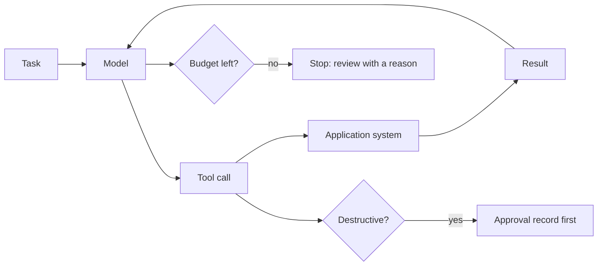

# Let it act

## The problem

The desk still books the sprayer crews by phone: which crew, which field, after which job. An agent can
read the request, check the label, look at the crews' schedules and book through the application system's
tools. An agent that says "booked" when nothing changed in the system is worse than no agent.

## Why it matters

How tools are written decides how well an agent uses them. Anthropic reports that rewriting a tool's
description "resulted in a 40% decrease in task completion time for future agents using the new description"
([Anthropic, How we built our multi-agent research system](https://www.anthropic.com/engineering/multi-agent-research-system)).
Their guide also says to grade what the agent produced in the system, not what it says it did.

## What you build



## The labs

- Core: [Design Tools for AI Agents with MCP](https://github.com/learnwithparam/live-labs/tree/main/labs/12-mcp-tools) (live-labs `labs/12-mcp-tools`, about 20 minutes)
- Core: [Authorize AI Agent Actions with RBAC and ABAC](https://github.com/learnwithparam/live-labs/tree/main/labs/22-agent-actions-authz) (live-labs `labs/22-agent-actions-authz`, about 20 minutes)
- Optional: [Cut Agent Token Costs with Context Engineering](https://github.com/learnwithparam/live-labs/tree/main/labs/13-context-engineering), [Add Long-Term Memory to AI Agents with Mem0](https://github.com/learnwithparam/live-labs/tree/main/labs/14-agent-memory), [Build a Deep Research Agent with Subagents](https://github.com/learnwithparam/live-labs/tree/main/labs/15-research-subagents), [Ship a Remote MCP Server with OAuth](https://github.com/learnwithparam/live-labs/tree/main/labs/20-remote-mcp-oauth)

## Steps

| Step                  | Minutes | You produce                                    | Done when (what the check reads)                                                                              |
| --------------------- | ------- | ---------------------------------------------- | ------------------------------------------------------------------------------------------------------------- |
| `write-the-tools`     | 20      | An MCP server over the world with 3 to 6 tools | A test client lists the tools; each has a description and typed input                                         |
| `explain-the-errors`  | 20      | Tool errors an agent can act on                | A bad argument returns a message that says what to do next, never a stack trace                               |
| `run-the-loop`        | 20      | An `act` verb                                  | The agent runs every dev task to an end state without crashing                                                |
| `grade-the-end-state` | 20      | End-state grading                              | The world's state after each run equals the expected state for the target share; the agent's claim is ignored |
| `stop-at-the-limit`   | 20      | Step and cost budgets                          | The planted runaway task stops within budget and lands in review with a reason                                |
| `ask-before-acting`   | 30      | An approval gate on destructive tools          | Zero destructive calls without an approval record across dev and 5 planted tasks                              |
| `test-the-path`       | 30      | A trajectory eval                              | Each golden task lists the expected tool order; the eval reports where the agent left it                      |
| `prove-the-agent`     | 20      | Scorecard line 5                               | Test tasks reach the target, zero unapproved destructive calls, lines 1 to 4 pass                             |

180 minutes of steps. `write-the-tools` and `run-the-loop` (40 minutes each in the brief) are split into two steps each. Calder Fen Electric Co-op (`worlds/README.md`) is the matching project brief. live-labs `labs/11-agent-loop` is a revamp candidate and is not a lesson until revamped.

## Walkthrough

TODO(part session): the commands for each step, each with an `Expect:` line. The steps above are planned and
have no folders yet, so this part has nothing to check:

```bash
bun run verify part let-it-act
```

Expect: `Part let-it-act is done: 0/0 steps pass.`
