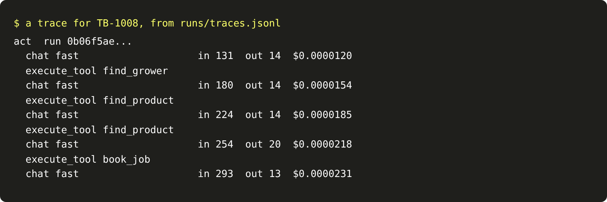

# Trace every run

## The problem

The co-op's manager asks two questions. What did the agent do on TB-1008? And what did that cost? Right now,
nobody can answer. `runs/calls.jsonl` holds every model call, but no call says which run it belonged to.
`runs/trace.jsonl` holds the tool calls, but no cost.

A trace answers both. A trace is a record of one run. It is made of spans. A span is one timed piece of work,
such as one model call or one tool call, with attributes such as tokens and cost.

## Your challenge

Give every run of the agent a trace, and send it to the trace store. `tracing.py` already builds spans and sends
them in OpenTelemetry's JSON format. You do not need to change it. Use it in `agent.py`:

- one `act` span for the whole run, with the run id;
- one `chat` span for each model call, with the role, the tokens and the cost;
- one `execute_tool` span for each tool call, with the tool's name.

Use the run id as the trace id, so a run id finds its trace. Three attribute names come from OpenTelemetry's
conventions for model calls: `gen_ai.request.model`, `gen_ai.usage.input_tokens` and
`gen_ai.usage.output_tokens`. The cost has no standard name yet, so this course uses `gen_ai.usage.cost`.
Put the role, such as `fast`, in `gen_ai.request.model`. A model id never goes in a trace.

For example, with the sample solution the trace for TB-1008 has 1 `act` span, 5 `chat` spans and 4
`execute_tool` spans. The first chat span has `"gen_ai.usage.input_tokens": 131` and a cost of about
$0.00001.

The check runs its own trace store and sets `TRACES_URL`. With no `TRACES_URL`, `tracing.py` writes each trace
to `runs/traces.jsonl`, so you can read it:

```bash
uv run world email TB-1008 | uv run python agent.py && tail -1 runs/traces.jsonl
```

Expect: the agent's JSON line, then one long line of JSON that starts with `{"resourceSpans"`. In the starter,
`tail` says `cannot open 'runs/traces.jsonl'`, because nothing writes a trace yet.



## Done when

- `contract.toml` names an `act` verb.
- Every run's `run_id` finds a trace in the trace store, with at least one chat span.
- Every chat span has the role, input tokens, output tokens and cost.
- Every tool call has an `execute_tool` span in its run's trace.
- The cost in the traces is within 1% of the cost in `runs/calls.jsonl`.

```bash
bun run verify trace-every-run
```

Expect: `Done. All 5 rules pass.`

## If you get stuck

- `model.Step` carries `input_tokens`, `output_tokens` and `cost_usd` for each call.
- Start the chat span before `model.next_step` and end it after, so the span's time is the call's time.
- Call `trace.send()` once, at the end of `act`.

## Words you will use

- **Trace:** every span of one run, joined by one trace id.
- **Span:** one timed piece of work, such as a model call, with attributes.
- **OpenTelemetry:** an open standard for traces. Trace stores such as Langfuse and Phoenix read it.
