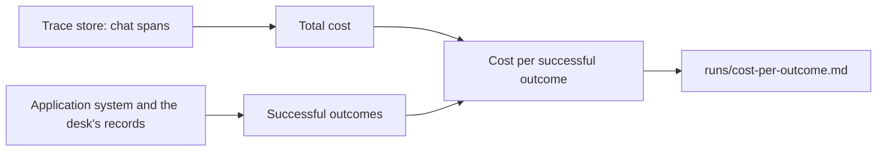

# Price each outcome

## The problem

The manager asks what the agent costs. "Total cost" is not the answer they need. Some runs end in a person's
queue, and those runs cost money too. The number that matters is the cost of one successful outcome: the total
spent, divided by the emails that ended as the desk's records say.

## Your challenge

Write `price.py`, the `price` verb. Run it after the agent has worked on every dev email. It reads every span
from the trace store with `tracing.stored_spans()`. It adds up `gen_ai.usage.cost` on the chat spans. It
counts the successful outcomes with `grade.grade()`. Then it writes `runs/cost-per-outcome.md` and prints
`{"runs", "total_usd", "successes", "per_success_usd"}`.

For example, here is a local run on the dev inbox. With no approval desk set up, jobs on big fields go to
review, so fewer runs succeed. It prints:

```json
{ "runs": 40, "total_usd": 0.00325223, "successes": 26, "per_success_usd": 0.00012509 }
```

The table in `runs/cost-per-outcome.md` has one row for the `act` verb:

| Verb | Runs | Total cost (USD) | Successful outcomes | Cost per successful outcome (USD) |
| ---- | ---- | ---------------- | ------------------- | --------------------------------- |
| act  | 40   | 0.00325223       | 26                  | 0.00012509                        |

Divide by 40 runs instead, and the cost looks 35% lower than it is.



## Done when

- `contract.toml` names a `price` verb. It exits 0 and prints the four numbers.
- `total_usd` is within 1% of the cost on the chat spans in the trace store.
- `successes` is the number of emails that ended as the desk's records say.
- `per_success_usd` is the total divided by the successes, within 1%.
- `runs/cost-per-outcome.md` has an `act` row with the successes.

```bash
bun run verify price-each-outcome
```

Expect: `Done. All 6 rules pass.`

## If you get stuck

- Count the runs by their `act` spans: there is one per run.
- `grade.grade()["matched"]` is the number of successful outcomes.
- Write the file into the folder that `RUNS_DIR` names, or `runs/` when it is not set.

## Words you will use

- **Outcome:** what a run left in the application system: a job, or an email with a person.
- **Successful outcome:** an outcome that matches the desk's own record.
- **Cost per successful outcome:** what you spend to get one right result, failed runs included.
