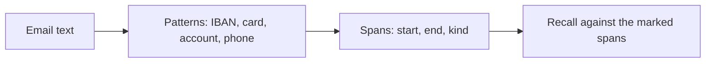

# Find private data

## The problem

Growers write more than spray requests. They add a phone number, a bank account for the bill, sometimes a card
number. The agent sends the whole email to the model. So the model provider stores those numbers in its logs.
The desk never needed to share them.

Before you can hide private data, you must find it. Private data here is a phone number, a bank account or a
card number.

## Your challenge

Write the detector in `privacy.py`, the `private` verb. It reads `{"text"}` on stdin and prints
`{"spans": [{"start", "end", "kind"}]}`. A span is where private data starts and ends in the text, counted in
characters from 0. The kind is `phone`, `bank_account` or `card`.

`data/private-dev.jsonl` in this part's folder is your annotated set. Each line is a dev email with a line
added, and the spans a person marked in it. For example, one line ends with:

> For the deposit use card 5500-0000-0000-0004. My mobile is +61 438 555 120.

Its spans are a `card` and a `phone`. Run the starter on it:

```bash
echo '{"text": "My mobile is +61 438 555 120."}' | uv run python privacy.py
```

Expect: `{"spans": []}` from the starter. The sample solution prints one `phone` span from 13 to 28.

The set has eight phone formats, four bank account formats and two card formats. The grader's set has other
numbers in the same kinds of format.



## Done when

- `contract.toml` names a `private` verb.
- Recall of private spans on `data/private-dev.jsonl` is 0.95 or more.
- At most 1 in 10 spans you report is not private data.
- Plain inbox emails, with rates and ids but nothing private, give no spans.

```bash
bun run verify find-private-data
```

Expect: `Done. All 4 rules pass.`

## If you get stuck

- Find the longest patterns first. An IBAN holds groups of four digits that also look like a card number.
- For a bank account, the number follows a word such as "account" or "acct". The word is not private.
- A rate such as 0.38 L/ha has too few digits to be a phone number. Make each pattern need enough digits.

## Words you will use

- **Private data:** details about a person that the job does not need, such as a phone number.
- **Recall:** the share of marked private spans your detector finds whole.
- **Annotated set:** texts with the right answers marked by a person.
