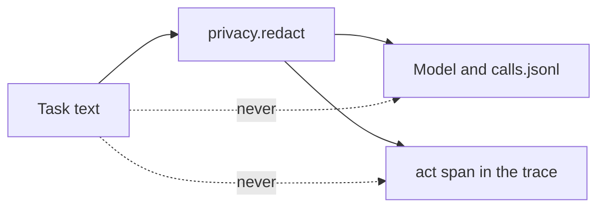

# Hide private data

## The problem

Your detector finds private data, but the agent does not use it yet. Every phone number in a task still
reaches the model. `model.py` writes each prompt into `runs/calls.jsonl`, the way a provider's logs keep it. The
trace keeps the task too, on the `act` span.

## Your challenge

Hide private data before anything else sees it. `privacy.redact()` replaces each span with its kind. Call it
on the task text at the start of `act`. Then use the redacted text everywhere: in the prompt, and on the `act`
span.

For example, one task is `worlds/tallgrass_bend/inbox/dev/TB-1005.txt` with this line added:

> Pay the crew from account 12-3456-0012345-00 and text 306.555.0110 when done.

After `redact()`, the model reads:

> Pay the crew from account [BANK_ACCOUNT] and text [PHONE] when done.

The request itself is untouched. So the agent still books Tillerguard on Butte View at 0.4 L/ha, as the desk
did.



## Done when

- No phone number, bank account or card from the tasks reaches `runs/calls.jsonl`.
- No private value reaches any span in the trace store.
- The work still gets done: each task is handled once, with zero wrong jobs.

```bash
bun run verify hide-private-data
```

Expect: `Done. All 3 rules pass.`

## If you get stuck

- Search the log yourself: `grep -c "306.555.0110" runs/calls.jsonl` should print 0.
- The trace is a second copy. Check what you put on the `act` span.
- Redact once, at the start. Every later step then works on the safe text.

## Words you will use

- **Redact:** to hide private data by replacing it, such as with `[PHONE]`.
- **Private list:** the values the check plants in tasks and then searches for in every log.
- **Leak:** a private value that reaches a log, a trace or a provider.
