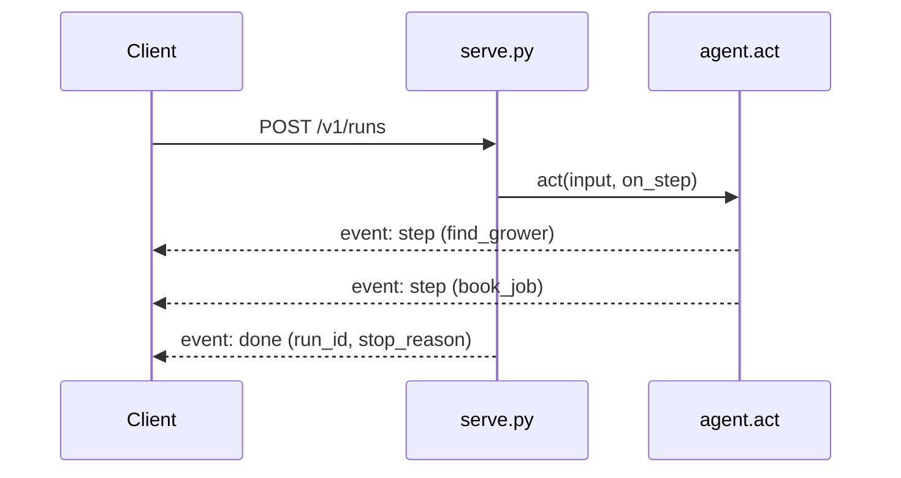

# Serve the contract

## The problem

The agent runs on one laptop, from a terminal. The desk wants to use it from its own screens, and the
co-op's other systems want to call it too. They need a service: an HTTP address that takes a task and
answers.

A run takes several model calls. If the client waits for the whole run, the screen shows nothing for a while,
and the person thinks it broke. So the service streams. It sends each step as it happens, and the summary at
the end.

## Your challenge

`serve.py` is the `serve` verb. It answers `POST /v1/runs` with `{"verb": "act", "input": {"email_id",
"text"}}`. Right now it waits for the whole run and answers with one JSON object. Make it stream with
server-sent events: one `step` event after each tool call, then one `done` event with the run's summary.

`agent.act` takes an `on_step` function. It calls that function after each tool call, so the server can send
the event at once.

For example, start the world and the service, each in its own terminal:

```bash
uv run world serve
```

Expect: `The spray desk is open at http://127.0.0.1:8100 (dev inbox). Stop it with Ctrl+C.`

```bash
PROJECT_API_TOKEN=secret PORT=8000 uv run python serve.py
```

Expect: `Serving the agent at http://127.0.0.1:8000/v1/runs. Stop it with Ctrl+C.`

Then send TB-1001 from a third terminal:

```bash
uv run world email TB-1001 | uv run python -c "import json,sys; print(json.dumps({'verb': 'act', 'input': json.load(sys.stdin)}))" > request.json
curl -sN -H "Authorization: Bearer secret" -d @request.json http://127.0.0.1:8000/v1/runs
```

Expect: with the starter, one JSON object at the end. With the sample solution, three `step` events, for
`find_grower`, `find_product` and `book_job`, then `event: done` with the `run_id`.



## Done when

- `contract.toml` names a `serve` verb.
- 20 calls to `POST /v1/runs` each answer 200 with `text/event-stream`.
- Each stream has `step` events, then a last `done` event with `run_id` and `stop_reason`.
- The world holds each of the 20 emails once.
- The 95th percentile time to the first event is under 5000 ms.

```bash
bun run verify serve-the-contract
```

Expect: `Done. All 5 rules pass.`

## If you get stuck

- An event is two lines and a blank line: `event: step`, then `data: {...}`. Flush after each one.
- Send the 200 status and the `Content-Type: text/event-stream` header before the run starts.
- The check sends a token with every call, so a service that already checks tokens still passes.

## Words you will use

- **Service:** a program that answers requests over HTTP.
- **Server-sent events:** a stream of named events over one HTTP answer.
- **Time to first event:** how long the client waits before it sees anything.
