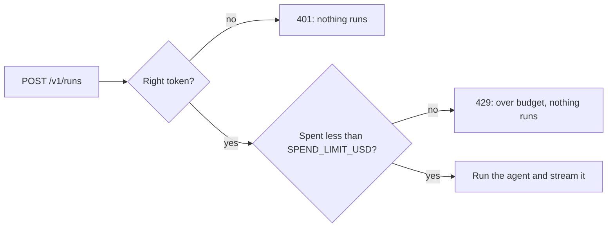

# Lock the endpoint

## The problem

The service answers anyone who can reach it. Anyone can book spray jobs, and every run costs money. A script
that calls the service in a loop could spend the month's budget in an afternoon.

## Your challenge

Add two checks to `serve.py`. Run both before the agent starts, never after it:

1. **Sign-in.** Every request needs the header `Authorization: Bearer <token>`, where the token is the
   `PROJECT_API_TOKEN` setting. A missing or wrong token gets 401 with a reason.
2. **Spending limit.** Add up the `cost_usd` of every run. Once the total reaches `SPEND_LIMIT_USD`, a new
   run gets 429 with a reason that names the budget.

For example, with the sample solution, a call with no token prints this, and the world gets no job:

```bash
curl -s -w " %{http_code}\n" -d @request.json http://127.0.0.1:8000/v1/runs
```

Expect: `{"error": "Send the header Authorization: Bearer <your token>."} 401`.

A run of TB-1001 costs about $0.00007. So with `SPEND_LIMIT_USD=0.0003`, about the fifth run gets 429, with a
reason such as `Over budget: runs have spent $0.0003... of $0.0003. Try later.`



## Done when

- A call with no token gets 401, and the world is not touched.
- A call with the wrong token gets 401, and the world is not touched.
- Calls with the right token run until the spending limit.
- Once the runs pass `SPEND_LIMIT_USD`, a call gets 429 with a reason, and nothing runs.

```bash
bun run verify lock-the-endpoint
```

Expect: `Done. All 4 rules pass.`

## If you get stuck

- Check before you run. A service that runs the agent and then answers 401 has already booked the job.
- Compare tokens with `hmac.compare_digest`, so the time a check takes does not give the token away.
- Several requests can arrive at once. Guard the running total with a `threading.Lock`.

## Words you will use

- **Bearer token:** a secret the client sends in the `Authorization` header to sign in.
- **401:** the HTTP status for "you are not signed in".
- **429:** the HTTP status for "too many requests"; here, the spending limit is reached.
