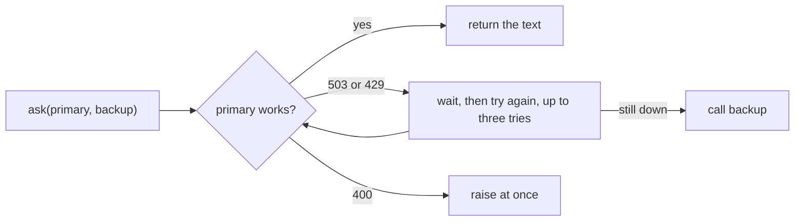

# Survive a provider outage

## The problem

One afternoon the model provider answers 503 for a few minutes. The agent calls it once, gets the error and
dies. Every email that arrived in that window is lost. A short outage should cost a short wait, not a lost
day. Some errors are different: a 400 means your request is wrong, and sending it again is wasted money.

## Your challenge

Open `resilient.py`. The function `ask` calls `primary` once. Change it so that it:

1. Tries again after a 503 or a 429, up to three tries, and waits longer each time (use the `sleep` it is given).
2. Calls `backup` once if all three tries fail.
3. Does not try again after any other error, such as a 400. It lets that error out at once.

For example, with a primary that fails twice and then works, `ask` should make three calls and wait twice.

```bash
cd parts/07-ship-it/02-survive-a-provider-outage/problem
python3 -c "from resilient import ask; print(ask(lambda p: 'hello ' + p, None, 'there'))"
```

Expect: `hello there`



## Do it on your work

Find the line in your own agent that calls the model. Wrap it in `ask`, and set your own backup: a second
model, or a message to a person. Good looks like this: you can unplug the network for a moment and the run
still ends with a clear result.

## Done when

- A primary that fails twice and then works is called three times, and its text comes back.
- The waits get longer each time.
- A primary that stays down hands the work to `backup` after a few tries.
- A 400 is raised at once, with one call and no backup.
- When both are down, the error comes out. It is not hidden.

```bash
bun run verify survive-a-provider-outage
```

Expect: `Done. All 5 rules pass.`

## If you get stuck

- The status is on the error: `error.status`.
- Double the wait after each failed try: half a second, then one second.
- Use `raise` on its own to pass the same error on.

## Words you will use

- **Outage:** a time when a service does not answer.
- **Backoff:** waiting longer after each failed try, so you do not pile on.
- **Fallback:** a second choice that takes over when the first one fails.
