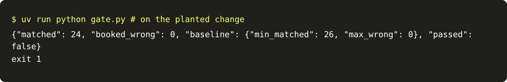

# Gate the release

## The problem

Someone trims the prompt to save tokens. They delete one line: "If a tool returns an error, read it and
follow its advice." Every test still passes. Nothing is booked wrong. But the agent stops fixing misspelled
products, so two dev emails that it used to book now go to a person. Nobody notices until the desk complains.

A release gate catches this. It is a regression eval that runs on every pull request. A regression eval checks
that the system still does everything it did before.

## Your challenge

Write `gate.py`, the `eval` verb. It starts its own fresh application system, runs the agent on every dev email,
and grades the end state. It compares the result with `evals/baseline.json`:

```json
{ "min_matched": 26, "max_wrong": 0 }
```

It prints `{"matched", "booked_wrong", "baseline", "passed"}`. It exits 0 when nothing got worse, and 1 on a
regression. Then finish `release-gate.yml`, so CI runs the gate on every pull request.

For example, the check makes the planted pull request: it deletes that one line from `prompt.md`. The sample
gate then prints:

```json
{
  "matched": 24,
  "booked_wrong": 0,
  "baseline": { "min_matched": 26, "max_wrong": 0 },
  "passed": false
}
```

It exits 1, so CI marks the pull request red. A gate that only counts wrong jobs sees `"booked_wrong": 0` and
lets the change through.



## Done when

- `contract.toml` names an `eval` verb.
- `release-gate.yml` runs on every pull request, with a step that runs the eval verb.
- On the clean folder, `eval` exits 0 and prints `"passed": true`.
- On the planted pull request, `eval` exits 1 and prints `"passed": false`.

```bash
bun run verify gate-the-release
```

Expect: `Done. All 4 rules pass.`

## If you get stuck

- Copy `release-gate.yml` to `.github/workflows/` in your own repo. Then open a pull request that deletes the
  line, and watch the check turn red.
- In CI nobody sits at the approval desk, so big fields go to review. The baseline of 26 counts that.
- Gate on what the system did before: the matched count and zero wrong jobs.

## Words you will use

- **Regression:** something that worked before and does not work now.
- **Release gate:** a check in CI that blocks a pull request when a regression eval fails.
- **Baseline:** the numbers the current version reaches. A change must not fall below them.
