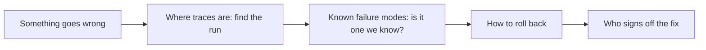

# Write the runbook

## The problem

The service is live, and something goes wrong while you are away. The person on duty did not build it. They
need to know how to put the last good version back, where the money limit is, where to look, and who decides.
A runbook is a short guide that tells the person on duty what to do when something goes wrong.

## Your challenge

Fill in `RUNBOOK.md`. It has five sections. Each one must hold something a person can act on, not a promise:

- **How to roll back:** the git command, in backticks.
- **Budget limit:** the limit in dollars, and the `SPEND_LIMIT_USD` setting that holds it.
- **Where traces are:** the trace store at `TRACES_URL`, and how a `run_id` finds one run.
- **Who signs off:** who says yes to a release, and to a big job.
- **Known failure modes:** three or more failures you saw, each with the dev email that shows it.

For example, one failure mode in the sample runbook is:

> - TB-1026: the grower writes "north block" and owns two north fields, so the agent guesses a field.
>   `book_job` refuses it and a person phones the grower.

A line such as "The model sometimes picks the wrong field" is true, but the person on duty cannot check it.
With an email id, they can rerun that email and see the failure for themselves.



## Done when

- `RUNBOOK.md` has all five sections, each with 15 or more words of your own.
- How to roll back gives the git command to run.
- Budget limit gives the limit in dollars and names `SPEND_LIMIT_USD`.
- Where traces are names `TRACES_URL` and says how to find one run by its `run_id`.
- Known failure modes lists three or more failures, each with a dev email id.

```bash
bun run verify write-the-runbook
```

Expect: `Done. All 5 rules pass.`

## If you get stuck

- Your traces and review queue from parts five and six are full of failure modes. Pick three you can rerun.
- Read the limit from `serve.py`: `SPEND_LIMIT_USD` is $0.05 unless the setting says otherwise.
- `git revert -m 1 <merge commit>` undoes a merged pull request without rewriting history.

## Words you will use

- **Runbook:** a short guide for the person on duty.
- **Roll back:** put the last good version back.
- **On duty:** the person who answers when the service has a problem.
