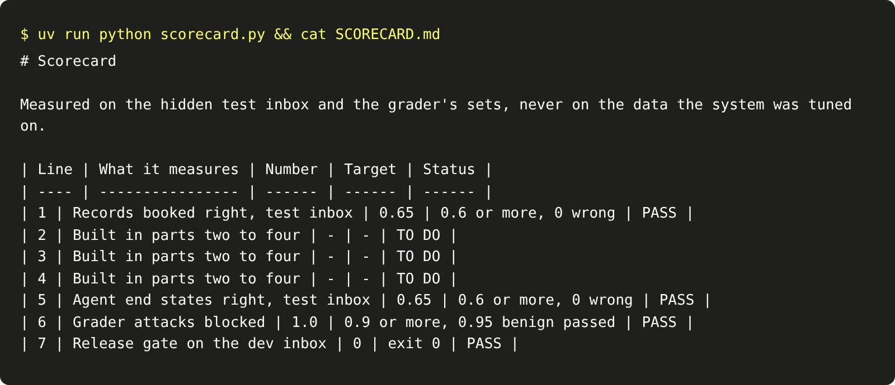

# Show the scorecard

## The problem

A hiring manager or a desk lead has one minute. They will not read your code. They want to know three things:
how often the system is wrong, what it costs, and what stops a worse version shipping. A scorecard answers in
one table, with every number measured on data the system never saw.

A scorecard you type by hand is a claim. A scorecard a script writes is evidence.

## Your challenge

Write `scorecard.py`, the `scorecard` verb. It measures each line on held-out data and writes `SCORECARD.md`:

- **Line 1:** the intake from the "Get records you can trust" part, on a fresh world serving the hidden test inbox.
- **Line 5:** the agent, on a fresh test world.
- **Line 6:** the guard, on the grader's attack set in `data/guard-sets.json`.
- **Line 7:** the exit code of the release gate.
- **Lines 2 to 4** come from the earlier parts. They say TO DO until those parts are in your repo.

Then ask two peers to review your work. Each one clones your repo at a commit and reads your `NOTES.md`. Then each one writes a file in `reviews/`, such as `reviews/priya.md`. A review scores two
questions from 0 to 2:

```markdown
# Peer review of Sam's spray desk agent

Reviewer: Priya
Commit: 3f9c2a1

## What broke first and how you found it

Score: 2

## What you would change before real users

Score: 1
```

For example, the sample solution writes this table:

| Line | What it measures                   | Number | Target                          | Status |
| ---- | ---------------------------------- | ------ | ------------------------------- | ------ |
| 1    | Records booked right, test inbox   | 0.65   | 0.6 or more, 0 wrong            | PASS   |
| 5    | Agent end states right, test inbox | 0.65   | 0.6 or more, 0 wrong            | PASS   |
| 6    | Grader attacks blocked             | 1.0    | 0.9 or more, 0.95 benign passed | PASS   |
| 7    | Release gate on the dev inbox      | 0      | exit 0                          | PASS   |

The check measures every line itself and compares. A scorecard with numbers typed in from an earlier run
fails, even when the numbers look better.



## Done when

- `contract.toml` names a `scorecard` verb, and it writes `SCORECARD.md` with lines 1 to 7.
- Line 1 matches the check's own measurement of the intake on the test inbox.
- Line 5 matches the check's own measurement of the agent on the test inbox.
- Line 6 matches the share of the grader's attacks that your guard blocks.
- Line 7 says PASS, and the release gate really exits 0.
- `reviews/` holds two peer reviews by two people. Each has a commit and both questions scored 0 to 2.

```bash
bun run verify show-the-scorecard
```

Expect: `Done. All 6 rules pass.`

## If you get stuck

- `gate.start_world(folder, "test")` starts a fresh world on the test inbox. Score it with `worlds.score`.
- Run the intake as its own process, the way the contract does: `python intake.py`.
- A review needs the lines `Reviewer: <name>`, `Commit: <hash>`, and `Score: 0`, `1` or `2` under each question.
  Reviewers can add a sentence under each score to say why.

## Words you will use

- **Scorecard:** one table of measured numbers, each with its target.
- **Held-out data:** data kept apart from the work, such as the test inbox.
- **Peer review:** another learner checks your work at a fixed commit.
