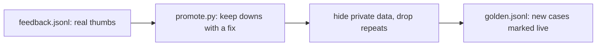

# Learn from live feedback

## The problem

Your golden set was written before launch, so it only holds the mistakes you could imagine. Real growers find
new ones. In `feedback.jsonl`, three people clicked thumbs down and typed what the answer should have been.
That is free, real test data, and it is lost if nobody moves it into the golden set.

## Your challenge

Open `promote.py`. It reads nothing yet. Make it add new cases to `golden.jsonl`:

1. Use only a thumbs-down that has a `fix`. The fix becomes the `expected` answer.
2. Add a question once, even when it shows up twice with other spacing or capital letters.
3. Hide any email address or phone number. Replace it with a tag such as `<email>`.
4. Mark each new case with `"source": "live"`, so you can tell it from the cases you wrote.
5. Running it twice must not add the same cases again.

```bash
cd parts/07-ship-it/055-learn-from-live-feedback/problem
python3 promote.py
```

Expect: `The golden set has 5 cases.` once you finish. The starter prints `Nothing promoted yet.`



## Do it on your work

Export a week of real thumbs, or the emails your team had to fix by hand. Run the same move on that file.
Good looks like this: each new case has a question, a fixed answer, `source: live`, and nobody's personal data.

## Done when

- The cases already in `golden.jsonl` are kept.
- Each thumbs-down with a fix is added once. Thumbs-up and downs with no fix are left out.
- A repeated question is counted once.
- No email address or phone number reaches the golden set.
- New cases say `source: live`, and a second run adds nothing.

```bash
bun run verify learn-from-live-feedback
```

Expect: `Done. All 5 rules pass.`

## If you get stuck

- Compare questions with `" ".join(text.lower().split())`. It lowers the case and squeezes the spaces.
- Keep a set of the questions you have seen, and add each new one to it as you go.
- Read the whole golden file first, then write it back once at the end.

## Words you will use

- **Golden set:** the questions with known right answers that you test against.
- **Feedback:** what a real user tells you about an answer, such as a thumbs up or down.
- **Private data:** anything that names a person, such as an email address or a phone number.
