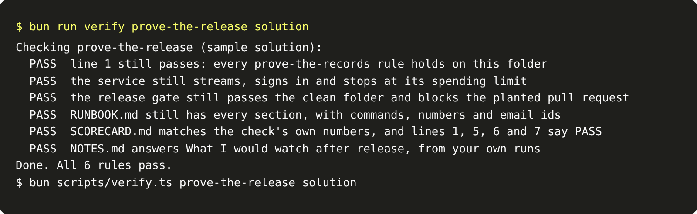

# Prove the release

## The problem

Each piece of the release passed its own check. A release fails when one piece breaks another. For example,
you add the release gate and forget the spending limit you set in `serve.py`. The final check runs every rule
again, on the one folder you would ship.

## Your challenge

Bring every piece together in this folder: the service, the gate, the runbook and the scorecard. Your part one
work is here too. Then answer one more question in `NOTES.md`: what you would watch after release.

The check reruns the rules of `prove-the-records`, `serve-the-contract`, `lock-the-endpoint`,
`gate-the-release`, `write-the-runbook` and `show-the-scorecard`. Then it reads your scorecard. Lines 1, 5, 6
and 7 must say PASS.

For example, a service with the limit left off still streams and still signs in. But the check sends eight
paid runs with `SPEND_LIMIT_USD=0.0003`, and no run gets 429. So the line about the service fails, and the
check names it:

> FAIL  the service still streams, signs in and stops at its spending limit



## Done when

- Line 1 still passes: every `prove-the-records` rule holds.
- The service still streams, signs in and stops at its spending limit.
- The release gate still passes the clean folder and blocks the planted pull request.
- `RUNBOOK.md` still has every section, with commands, numbers and email ids.
- `SCORECARD.md` matches the check's numbers, and lines 1, 5, 6 and 7 say PASS.
- `NOTES.md` answers What I would watch after release.

```bash
bun run verify prove-the-release
```

Expect: `Done. All 6 rules pass.`

## If you get stuck

- `bun run verify <step-name>` always checks that step's own folder, not this one. So run each piece here
  instead. For example, `uv run python gate.py` must print `"passed": true`, and `uv run python scorecard.py`
  must show PASS on lines 1, 5, 6 and 7.
- Use the same settings names everywhere: `PROJECT_API_TOKEN`, `SPEND_LIMIT_USD`, `TRACES_URL`.
- Write the NOTES answer last, from what the scorecard and the traces show.

## Words you will use

- **Release:** the version you put in front of real users.
- **Milestone:** a step that proves a whole part. This one is line 7 of your scorecard.
- **Regression:** something that worked before and does not work now.
