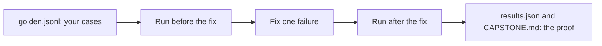

# Prove it on your work

## The problem

Every step so far ran on the spray desk. A course is only worth something if it works on your own job. This step
is the proof. You bring your own questions, run your own system, fix one failure and show the number moved.

The check does not look at the spray desk at all. It reads your files, and it asks for evidence. For example, a library desk shows 7 of 12 cases passing before its fix and 10 of 12 after.

## Your challenge

This folder is the template. Replace each file with your own work:

1. `golden.jsonl`: at least ten real cases from your own job. Each has a `question`, an `expected` answer and a
   `kind`. Use at least two kinds, such as `normal`, `edge` and `unsafe`.
2. `results.json`: how many cases passed before your fix and after it, and each case that still fails with a
   reason in your own words.
3. `CAPSTONE.md`: the job, the numbers, the one fix, the evidence and what is next.

```bash
cd parts/07-ship-it/09-prove-it-on-your-work/problem
wc -l golden.jsonl
```

Expect: `1 golden.jsonl` for the template. You will have ten or more.



## Do it on your work

This step is the work. Good looks like this: a stranger reads the three files. They can tell what you built and how you tested it. They can also tell what is still broken.

## Done when

- `golden.jsonl` has at least ten different cases, in at least two kinds, and none from the spray desk.
- `results.json` totals match your case count, and more cases pass after than before.
- Each case that still fails is listed, with a reason, and is a case from your golden file.
- `CAPSTONE.md` has all five sections written.
- Its Number section states the same before and after counts as `results.json`.
- Its Evidence section names `golden.jsonl` and `results.json`.

```bash
bun run verify prove-it-on-your-work
```

Expect: `Done. All 6 rules pass.`

## If you get stuck

- Short on cases? Use real emails, tickets or chats from last month. Do not invent them.
- The number did not move? Pick a smaller failure and fix only that.
- The check does not run your system. It reads the shape and the evidence, so keep your run logs too.

## Words you will use

- **Capstone:** the last project, on your own work, that shows what you can do.
- **Evidence:** a file or number someone else can check.
- **Case kind:** the type of case, such as a normal one, an edge one, or one that should be refused.
