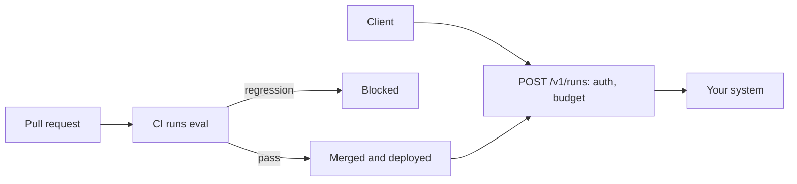

# Ship it

## The problem

The system runs on one laptop. The desk needs a service with sign-in and a cost limit, and the team
needs a gate that stops a worse prompt from shipping, the same way a failing test stops a worse function.

## Why it matters

Anthropic's guide to evals separates two kinds: capability evals that should start low, and regression
evals that ask "Does the agent still handle all the tasks it used to?" and "should have a nearly 100% pass
rate" ([Anthropic, Demystifying evals for AI agents](https://www.anthropic.com/engineering/demystifying-evals-for-ai-agents)).
A release gate is a regression eval that runs on every pull request.

## What you build



## The labs

- Core: [Gate AI Releases with Evals in CI](https://github.com/learnwithparam/live-labs/tree/main/labs/29-evals-ci) (live-labs `labs/29-evals-ci`, about 20 minutes)
- Core: [Ship a Streaming AI Agent API with an API Gateway](https://github.com/learnwithparam/live-labs/tree/main/labs/31-agent-api) (live-labs `labs/31-agent-api`, about 20 minutes)
- Optional: [Run Background Coding Agents with Cloud Sandboxes](https://github.com/learnwithparam/live-labs/tree/main/labs/32-background-agents), [Run AI Agents on Serverless with Durable Functions](https://github.com/learnwithparam/live-labs/tree/main/labs/33-serverless-agents), [Fine-Tune a Small LLM with Reviewed Data](https://github.com/learnwithparam/live-labs/tree/main/labs/34-fine-tune), [Serve Open LLMs with Serverless vLLM](https://github.com/learnwithparam/live-labs/tree/main/labs/35-serverless-gpu)

## Steps

| Step | Minutes | You produce | Done when (what the check reads) |
|---|---|---|---|
| `serve-the-contract` | 20 | `POST /v1/runs` with streaming | The HTTP contract check passes on 20 calls; time to first token is printed |
| `lock-the-endpoint` | 20 | Auth and a cost limit | A bad token gets 401; a run over budget is refused with a reason |
| `gate-the-release` | 30 | A CI workflow that runs `eval` | A planted pull request fails CI and the clean one passes |
| `write-the-runbook` | 20 | `RUNBOOK.md` | How to roll back, Budget limit, Where traces are, Who signs off, Known failure modes from part two |
| `show-the-scorecard` | 30 | `SCORECARD.md`, generated | All seven lines green on the test split; two peer reviews filed at the reviewed commit |
| `prove-the-release` | 20 | Scorecard line 7 | Every line passes on the grader's run |

140 minutes of steps. `serve-the-contract` (40 minutes in the brief) is split into `serve-the-contract` and `lock-the-endpoint`.

## Walkthrough

TODO(part session): the commands for each step, each with an `Expect:` line. The steps above are planned and
have no folders yet, so this part has nothing to check:

```bash
bun run verify part ship-it
```

Expect: `Part ship-it is done: 0/0 steps pass.`
