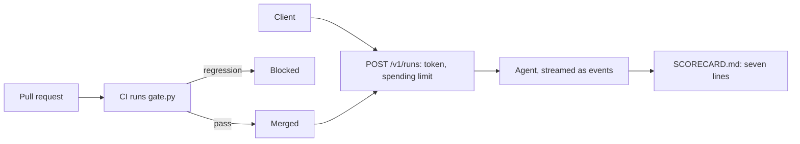

# Ship it

## The problem

The system runs on one laptop. The desk needs a service that other people can use. It needs a sign-in and a
spending limit. The team also needs a gate that stops a worse prompt from shipping, the way a failing test stops
a worse function.

For example, someone trims the prompt in a pull request. They delete the line "If a tool returns an error, read
it and follow its advice." Nothing is booked wrong. But the agent stops fixing misspelled products, such as
"Stemshure" in `worlds/tallgrass_bend/inbox/dev/TB-1008.txt`. The matched count on the dev inbox drops from
26 to 24. The release gate runs the evals in CI, sees the drop, and blocks the merge.

## Why it matters

Anthropic's guide to evals names two kinds. Capability evals test new skills, and they should start with a low
score. Regression evals check that old work still passes. The guide says they "should have a nearly 100% pass
rate". Each one asks: "Does the agent still handle all the tasks it used to?"
([Anthropic, Demystifying evals for AI agents](https://www.anthropic.com/engineering/demystifying-evals-for-ai-agents)).
A release gate is a regression eval that runs on every pull request.

## What you build



CI means continuous integration: a service that runs your checks on every pull request. A runbook is a short
guide that tells the person on duty what to do when something goes wrong.

## The labs

- Core: [Gate AI Releases with Evals in CI](https://github.com/learnwithparam/live-labs/tree/main/labs/29-evals-ci) (live-labs `labs/29-evals-ci`, about 20 minutes)
- Core: [Ship a Streaming AI Agent API with an API Gateway](https://github.com/learnwithparam/live-labs/tree/main/labs/31-agent-api) (live-labs `labs/31-agent-api`, about 20 minutes)
- Optional, pick any:
  - [Run Background Coding Agents with Cloud Sandboxes](https://github.com/learnwithparam/live-labs/tree/main/labs/32-background-agents)
  - [Run AI Agents on Serverless with Durable Functions](https://github.com/learnwithparam/live-labs/tree/main/labs/33-serverless-agents)
  - [Fine-Tune a Small LLM with Reviewed Data](https://github.com/learnwithparam/live-labs/tree/main/labs/34-fine-tune)
  - [Serve Open LLMs with Serverless vLLM](https://github.com/learnwithparam/live-labs/tree/main/labs/35-serverless-gpu)

## Steps

| Step                                                          | Minutes | You produce                          | The check reads                                                  |
| ------------------------------------------------------------- | ------- | ------------------------------------ | ---------------------------------------------------------------- |
| [serve-the-contract](01-serve-the-contract/problem/README.md) | 20      | `POST /v1/runs` with streaming       | 20 HTTP calls: status, events, time to first event, the world    |
| [lock-the-endpoint](02-lock-the-endpoint/problem/README.md)   | 20      | A token check and a spending limit   | 401 and 429 answers, and no writes in the world for them         |
| [gate-the-release](03-gate-the-release/problem/README.md)     | 30      | `gate.py` and `release-gate.yml`     | The gate's exit code on the clean folder and on a planted change |
| [write-the-runbook](04-write-the-runbook/problem/README.md)   | 20      | `RUNBOOK.md`                         | Five sections, a git command, the limit, real email ids          |
| [show-the-scorecard](05-show-the-scorecard/problem/README.md) | 30      | A `scorecard` verb, two peer reviews | `SCORECARD.md` against the check's own measurements              |
| [prove-the-release](06-prove-the-release/problem/README.md)   | 20      | `NOTES.md`, the whole release        | Every earlier rule again, and lines 1, 5, 6 and 7 on PASS        |

The steps take 140 minutes in total.

You work in each step's `problem/` folder, which starts from the answer to the step before it. The folders
hold the agent from parts five and six, with its tools, traces, redaction and guards.

## Walkthrough

Start the application system in one terminal:

```bash
uv run world serve
```

Expect: `The spray desk is open at http://127.0.0.1:8100 (dev inbox). Stop it with Ctrl+C.`

Start the service in a second terminal, from a step's `problem/` folder:

```bash
PROJECT_API_TOKEN=secret PORT=8000 uv run python serve.py
```

Expect: `Serving the agent at http://127.0.0.1:8000/v1/runs. Stop it with Ctrl+C.`

From `gate-the-release` on, run the release gate. It starts its own world, so it needs neither terminal:

```bash
uv run python gate.py
```

Expect: `{"matched": 26, "booked_wrong": 0, "baseline": {"min_matched": 26, "max_wrong": 0}, "passed": true}`
once the gate is written.

Check one step at any time:

```bash
bun run verify serve-the-contract
```

Expect: `FAIL` lines with `Try next:` until the service streams, then `Done. All 5 rules pass.`

Check the whole part:

```bash
bun run verify part ship-it
```

Expect: one line per step, then `Part ship-it is done: 6/6 steps pass.` once every step passes.

## Finished

Your agent is now a service. It streams each step, signs in every caller, and stops at a spending limit. A gate
in CI blocks a prompt change that loses work, even when nothing is booked wrong. A runbook tells the person on
duty what to do, and a scorecard measured on held-out data shows every line. That is the project you hand in.

Next, in [Add one capability](../08-add-one-capability/README.md), you pick one elective your job needs. It
could be voice, photos or a cheaper model. You measure it with the same scorecard.
