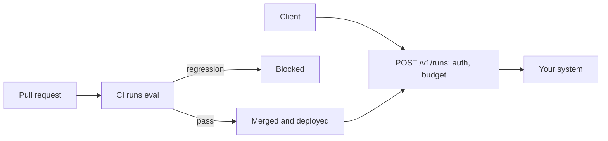

# Ship it

## The problem

The system runs on one laptop. The desk needs a service that other people can use. It needs a sign-in and a
cost limit. The team also needs a gate that stops a worse prompt from shipping. A failing test stops a worse
function in the same way.

For example, someone changes the extract prompt in a pull request. Say the new prompt makes the system book
TB-1006 at 0.97 L/ha, the acre number. Then the number after `Booked wrong:` is no longer 0. The release gate
runs the evals in CI, sees the wrong booking, and blocks the merge.

## Why it matters

Anthropic's guide to evals names two kinds. Capability evals test new skills, and they should start with a
low score. Regression evals check that old work still passes. The guide says they "should have a nearly 100% pass rate".
Each one asks: "Does the agent still handle all the tasks it used to?"
([Anthropic, Demystifying evals for AI agents](https://www.anthropic.com/engineering/demystifying-evals-for-ai-agents)).
A release gate is a regression eval that runs on every pull request.

## What you build



CI means continuous integration: a service that runs your checks on every pull request. A runbook is a short
guide that tells the person on duty what to do when something goes wrong.

## The labs

- Core: [Gate AI Releases with Evals in CI](https://github.com/learnwithparam/live-labs/tree/main/labs/29-evals-ci) (live-labs `labs/29-evals-ci`, about 20 minutes)
- Core: [Ship a Streaming AI Agent API with an API Gateway](https://github.com/learnwithparam/live-labs/tree/main/labs/31-agent-api) (live-labs `labs/31-agent-api`, about 20 minutes)
- Optional, pick any:
  - [Run Background Coding Agents with Cloud Sandboxes](https://github.com/learnwithparam/live-labs/tree/main/labs/32-background-agents)
  - [Run AI Agents on Serverless with Durable Functions](https://github.com/learnwithparam/live-labs/tree/main/labs/33-serverless-agents)
  - [Fine-Tune a Small LLM with Reviewed Data](https://github.com/learnwithparam/live-labs/tree/main/labs/34-fine-tune)
  - [Serve Open LLMs with Serverless vLLM](https://github.com/learnwithparam/live-labs/tree/main/labs/35-serverless-gpu)

## Steps

| Step                 | Minutes | You produce                    | Done when (what the check reads)                                                                   |
| -------------------- | ------- | ------------------------------ | -------------------------------------------------------------------------------------------------- |
| `serve-the-contract` | 20      | `POST /v1/runs` with streaming | The HTTP contract check passes on 20 calls; time to first token is printed                         |
| `lock-the-endpoint`  | 20      | Auth and a cost limit          | A bad token gets 401; a run over budget is refused with a reason                                   |
| `gate-the-release`   | 30      | A CI workflow that runs `eval` | A planted pull request fails CI and the clean one passes                                           |
| `write-the-runbook`  | 20      | `RUNBOOK.md`                   | How to roll back, Budget limit, Where traces are, Who signs off, Known failure modes from part two |
| `show-the-scorecard` | 30      | `SCORECARD.md`, generated      | All seven lines green on the test split; two peer reviews filed at the reviewed commit             |
| `prove-the-release`  | 20      | Scorecard line 7               | Every line passes on the grader's run                                                              |

The steps take 140 minutes in total. The brief planned `serve-the-contract` as one step of 40 minutes. Here
it is split into `serve-the-contract` and `lock-the-endpoint`.

## Walkthrough

TODO(part session): the commands for each step, each with an `Expect:` line. The steps above are planned.
They have no folders yet, so this part has nothing to check:

```bash
bun run verify part ship-it
```

Expect: `Part ship-it is done: 0/0 steps pass.`
