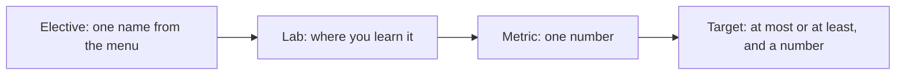

# Pick an elective

## The problem

There are many things you could add to the spray desk. A team that adds one "to see what happens" learns
nothing. Nobody wrote down what it should change, so nobody can say if it worked. Pick one capability and the
one number it should move before you build anything.

## Your challenge

Fill in `elective.md` in this folder. Pick one elective from the menu. Name its lab, the number it should move,
and the target for that number.

| Elective                  | Lab                                              | A number it can move on the spray desk |
| ------------------------- | ------------------------------------------------ | -------------------------------------- |
| `route-to-cheaper-models` | `labs/26-llm-gateway`                            | cost per correct booking               |
| `run-it-overnight`        | `labs/03-batch-prompts`                          | total cost                             |
| `remember-the-grower`     | `labs/14-agent-memory`                           | share booked correctly                 |
| `tune-a-small-model`      | `labs/34-fine-tune`                              | cost per correct booking               |
| `split-the-research`      | `labs/15-research-subagents`                     | needs your own brief                   |
| `read-the-photos`         | `labs/18-vision-damage`                          | needs your own brief                   |
| `add-a-voice-line`        | `labs/16-voice-pipecat` or `labs/17-voice-phone` | needs your own brief                   |

The metric must be one of four numbers the scorecard measures:

- cost per correct booking
- total cost
- model calls
- share booked correctly

For example, the sample answer picks `route-to-cheaper-models`. Today `cost.py` prints
`"per_correct_booking_usd": 2.3705000000000004e-05` on the dev inbox. That is about $0.0000237 for each job booked right.
So the sample target is "at most $0.000022".



## Done when

- `elective.md` has the sections Elective, Lab, Metric, Target and Why, each written.
- The Elective names exactly one elective from the menu.
- The Lab is the lab for that elective.
- The Metric is one of the four numbers.
- The Target has a direction and a number. A cost or a count goes down, so it says "at most". A share goes up,
  so it says "at least".

```bash
bun run verify pick-an-elective
```

Expect: `Done. All 5 rules pass.`

## If you get stuck

- Run part one's `cost.py` after an intake run to see today's numbers. Set your target from them.
- Photos, voice and research need data the spray desk does not have yet. Pick them only for your own brief,
  and agree the metric with your instructor.
- A target such as "as low as we can" can never fail, so it cannot guide you.

## Words you will use

- **Elective:** one extra capability you choose, beyond the core parts.
- **Target:** the value your metric must reach for the elective to count as done.
- **Router:** code that picks the cheapest way to handle each request.
