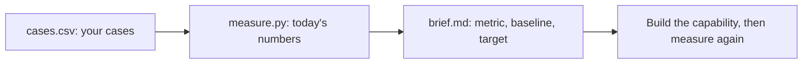

# Bring your own brief

## The problem

The other electives use the spray desk's data. Many of you need a capability the spray desk cannot test, such
as photos, voice or research. Without your own cases, nobody can say if it worked. This step is the kit for
that: a brief with a number you measured yourself, and a file of real cases behind it. For example, a library desk checks twelve calls, finds 9 right, and writes "75% today, at least 85% wanted".

## Your challenge

This folder is your kit. Make it yours:

1. Replace `cases.csv` with at least ten of your own cases. One row for each case: a name, `yes` or `no` for
   whether the result was right, and what it cost in dollars. Use your own work, not the spray desk.
2. Run `measure.py` on it to get today's numbers.
3. Fill in `brief.md`. Pick one metric, copy its baseline from `measure.py`, and set a target that beats it.

```bash
cd parts/08-add-one-capability/02-bring-your-own-brief/problem
python3 measure.py cases.csv
```

Expect: one line of JSON with `cases`, `share_correct`, `total_cost_usd` and `cost_per_correct_usd`.



## Do it on your work

This whole step is on your work. Good looks like this: a stranger could open `cases.csv`, run `measure.py`,
and get the number in your Baseline.

## Done when

- `cases.csv` has at least ten cases with a name, `yes` or `no`, and a cost.
- None of the cases come from the spray desk.
- Every section of `brief.md` is written.
- The Metric is share correct, cost per correct, or total cost.
- The Baseline matches what your own cases give.
- The Target points the right way and beats the Baseline.
- The Evidence names `cases.csv`.

```bash
bun run verify bring-your-own-brief
```

Expect: `Done. All 6 rules pass.`

## If you get stuck

- "At least" goes with a share, because a share should go up. "At most" goes with a cost, because it should go down.
- Percent or fraction are both fine: `75%` and `0.75` mean the same here.
- The check works out the numbers from your `cases.csv`. It does not run your files.

## Words you will use

- **Brief:** one page that says what you will add, how you will measure it and what number you want.
- **Baseline:** the number today, before you change anything.
- **Target:** the number you want to reach.
