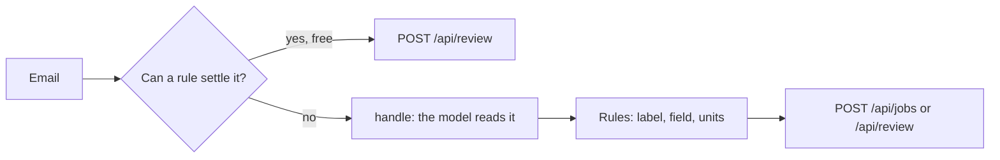

# Build the elective

## The problem

Your intake from the "Get records you can trust" part works and is safe. A new capability must not break that. So you do not rewrite
`intake.py`. You build the elective as a new verb, `elective`, that does the same job with the capability
added. Then the old verb and the new verb can run side by side on the same inbox.

## Your challenge

Finish `elective.py` in this folder. It reads every email on the desk, adds your elective, and books each email
or sends it to a person, once. It reuses `handle` and `send_to_review` from `intake.py`, so the label and field
rules stay the same.

For example, the sample answer is a router. Some emails give the rate per acre. `intake.py` always sends those
to a person, whatever the model says. So the router sends them to a person first, with no model call:

```python
def reason_a_rule_can_give(email: dict) -> str | None:
    if MENTIONS_ACRES.search(email["text"]):
        return "the rate is given per acre; the desk books L/ha"
    return None
```

Every other email goes to `handle`, which asks the model as before.



With the world serving in a second terminal, run your new verb:

```bash
uv run world reset && rm -rf runs && uv run python elective.py
```

Expect: `{"booked": 26, "review": 10, "settled_by_rule": 4}` for the sample answer. Yours shows your own counts.

## Done when

- `contract.toml` names an `elective` verb, and still names `intake`.
- `elective.md` still passes every `pick-an-elective` rule.
- The `elective` verb runs on the dev inbox with no crash, over 3 fresh runs.
- It books or sends every email to a person, once.
- It books zero jobs wrong and zero jobs off label.

```bash
bun run verify build-the-elective
```

Expect: `Done. All 5 rules pass.`

## If you get stuck

- A rule that settles an email must still call `send_to_review`. Otherwise the email is lost, and no person
  ever sees it.
- Copy `elective.md` from your `pick-an-elective` folder if you started this step fresh.
- If you picked another elective, keep the same shape: same inbox, same rules, one new idea in front of the
  model or inside `handle`.

## Words you will use

- **Verb:** a command named in `contract.toml`. The checks run it, so any language works.
- **Settled by rule:** an email a plain rule can decide with no model call.
- **Lost email:** an email that was neither booked nor sent to a person.
