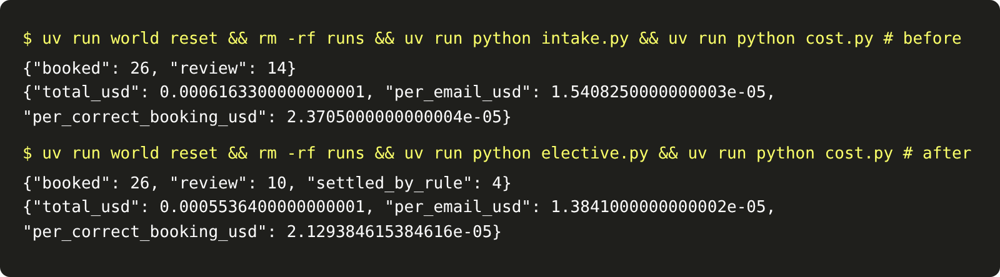
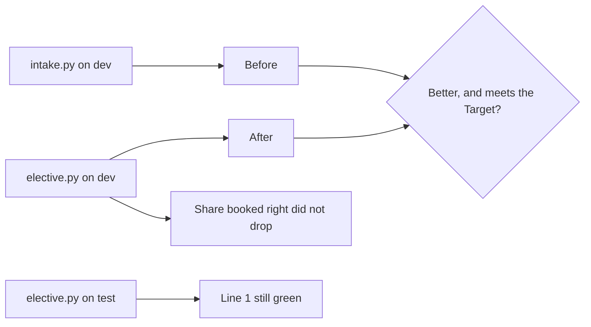

# Measure the elective

## The problem

"It feels cheaper" is not a result. You need the same number twice: once from the old verb and once from the
new one, on the same inbox. And a number can move the right way for the wrong reason. A router that sends half
the inbox to a person spends less on the model, but the desk now does that work by hand.

## Your challenge

Run `intake.py` and then `elective.py`, each on a fresh world. After each run, run `cost.py`. Write the number
your Metric names under `## Before` and `## After` in `elective.md`.

With the world serving in a second terminal:

```bash
uv run world reset && rm -rf runs && uv run python intake.py && uv run python cost.py
```

Expect: `{"booked": 26, "review": 14}`, then a line with `"per_correct_booking_usd": 2.3705000000000004e-05` (the Before).

```bash
uv run world reset && rm -rf runs && uv run python elective.py && uv run python cost.py
```

Expect: `{"booked": 26, "review": 10, "settled_by_rule": 4}`, then `"per_correct_booking_usd": 2.129384615384616e-05`.



For example, the sample answer writes "$0.0000237 per correct booking" under Before and "$0.0000213" under
After. The cost fell by about 10%, and the elective still booked 26 jobs right.

Then prove it on emails you have not seen. First stop the dev world with Ctrl+C, because both use port 8100.
Then serve the test inbox:

```bash
uv run world serve --split test
```

Expect: `The spray desk is open at http://127.0.0.1:8100 (test inbox). Stop it with Ctrl+C.`

In your other terminal, run the elective on the test inbox:

```bash
uv run world reset && rm -rf runs && uv run python elective.py
```

Expect: `{"booked": 13, "review": 5, "settled_by_rule": 2}` for the sample answer. Here `cost.py` prints
`"per_correct_booking_usd": null`, because the desk's test records are hidden. The check scores this run.



## Done when

- `elective.md` has a Before and an After section, each with a number.
- The Before number is your metric from `intake` on the dev inbox.
- The After number is your metric from `elective` on the dev inbox.
- The metric moved the better way and meets your Target.
- The share booked correctly did not drop.
- On the hidden test inbox, the elective keeps line 1 of the scorecard: zero jobs wrong or off label, every
  email handled once, at least 60% booked right, and under $0.01 in model calls.

```bash
bun run verify measure-the-elective
```

Expect: `Done. All 6 rules pass.`

## If you get stuck

- Delete `runs/` before each run. `calls.jsonl` grows with every run, so an old run adds to the cost.
- A rounded number is fine. The check allows a 2% gap, so $0.0000213 matches 2.129384615384616e-05.
- If your cost fell but the share booked right fell too, your rule is too wide. Find the emails it now sends
  to a person that intake booked right.

## Words you will use

- **Before and after:** the same metric, on the same inbox, from the old verb and the new one.
- **Trade:** what you gave up to move the metric, such as quality, speed or more code to keep.
- **Scorecard line:** one goal the system must keep meeting. Line 1 is from part one.
