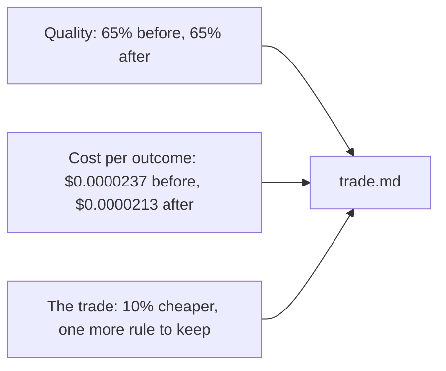

# Report the trade

## The problem

The co-op's manager will not read your code. They ask three questions. Is it still right as often? What does
each good booking cost now? And what did we give up? A report that says "much cheaper" without numbers cannot
answer them. A report that copies the target instead of the run is worse: it states a result nobody measured.

## Your challenge

Write `trade.md` in this folder with three sections. Each number must come from your runs in
`measure-the-elective`, not from your target.

- **Quality:** the share of dev emails booked right, before and after, as a percent.
- **Cost per outcome:** the cost per correct booking, before and after.
- **The trade:** the change in cost per correct booking as a percent, and what it bought or cost you.

For example, the sample answer writes:

> The router cuts the cost per correct booking by 10%, and quality stays the same. The price is one more rule
> to look after.

The 10% comes from the run: ($0.0000237 - $0.0000213) / $0.0000237 is about 10%.



## Done when

- `trade.md` has the sections Quality, Cost per outcome and The trade, each written.
- Quality gives the share booked correctly before and after, as measured on dev.
- Cost per outcome gives the cost per correct booking before and after, as measured.
- The trade names the change in cost per correct booking as a percent, within 2 points of the run, in at
  least 15 words.

```bash
bun run verify report-the-trade
```

Expect: `Done. All 4 rules pass.`

## If you get stuck

- The share booked right is `booked_correct` divided by the emails in the inbox. 26 of 40 is 65%.
- Cost per outcome is always the cost per correct booking here, even if your Metric is another number. A
  manager compares electives by it.
- If the share did not change, say so: "65% before and after" counts for both.

## Words you will use

- **Cost per outcome:** what one useful result cost. Here, one job booked right.
- **Percent change:** the gap between Before and After, divided by Before, times 100.
- **Write-up:** a short report a manager can act on without opening the code.
