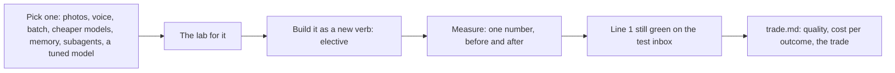

# Add one capability

## The problem

Every business needs one thing that the core course does not cover. At the spray desk, it could be one of
these:

- photos of damaged crops
- a phone line for growers
- a whole season's requests, run overnight
- cheaper models for easy requests

Pick the one your project needs. Then prove that it moved a number, without breaking the scorecard.

For example, you could try a cheaper path for easy requests. Today `uv run finished` reports
`Model calls: 40, cost $0.000616` on the dev inbox. Four of those calls read emails that give the rate per
acre. Those emails always go to a person, whatever the model says. A router can send them to a person with no
model call. The cost goes down, and the scorecard still shows `Booked wrong: 0`.

## Why it matters

Cost is often the capability that matters most. Prompt caching means the provider saves the parts of a
prompt that repeat between calls. Anthropic reports that it cuts "latency by > 2x and costs by up to 90%" for
those prompts ([Anthropic, Introducing Contextual Retrieval](https://www.anthropic.com/engineering/contextual-retrieval)).
Latency is how long you wait for an answer. Like every number in this course, it counts only once you measure
it on your own runs.

## What you build



## The labs

- Optional, pick the one for your elective:
  - [Process a Million Prompts with Batch APIs](https://github.com/learnwithparam/live-labs/tree/main/labs/03-batch-prompts)
  - [Build a Voice AI Agent with Pipecat](https://github.com/learnwithparam/live-labs/tree/main/labs/16-voice-pipecat)
  - [Build a Phone AI Agent with LiveKit](https://github.com/learnwithparam/live-labs/tree/main/labs/17-voice-phone)
  - [Read Images with Vision LLMs](https://github.com/learnwithparam/live-labs/tree/main/labs/18-vision-damage)
  - [Add Long-Term Memory to AI Agents with Mem0](https://github.com/learnwithparam/live-labs/tree/main/labs/14-agent-memory)
  - [Build a Deep Research Agent with Subagents](https://github.com/learnwithparam/live-labs/tree/main/labs/15-research-subagents)
  - [Route LLM Calls with an LLM Gateway](https://github.com/learnwithparam/live-labs/tree/main/labs/26-llm-gateway)
  - [Fine-Tune a Small LLM with Reviewed Data](https://github.com/learnwithparam/live-labs/tree/main/labs/34-fine-tune)

## Steps

| Step                                                              | Minutes | You produce                                      | The check reads                                                    |
| ----------------------------------------------------------------- | ------- | ------------------------------------------------ | ------------------------------------------------------------------ |
| [pick-an-elective](01-pick-an-elective/problem/README.md)         | 10      | `elective.md`: the capability and its number     | One elective, its lab, a scorecard metric and a target             |
| [build-the-elective](02-build-the-elective/problem/README.md)     | 30      | An `elective` verb beside `intake`               | The world after 3 fresh runs: no crash, every email handled once   |
| [measure-the-elective](03-measure-the-elective/problem/README.md) | 30      | Before and After numbers in `elective.md`        | Both verbs' runs scored by the world, and line 1 on the test inbox |
| [report-the-trade](04-report-the-trade/problem/README.md)         | 20      | `trade.md`: quality, cost per outcome, the trade | Each number against the measured runs                              |

The steps take 90 minutes in total. The lab for your elective adds about 30 minutes. Labs 16, 25 and 34 need
an Apple silicon computer today. They may be rebuilt later to run online.

The sample answer builds `route-to-cheaper-models`. The cheapest model is no model: a plain rule settles the
emails that go to a person anyway. Photos, voice and research need data the spray desk does not have yet, so
take those only into your own brief.

## Walkthrough

Start the application system in a second terminal. Leave it running while you work:

```bash
uv run world serve
```

Expect: `The spray desk is open at http://127.0.0.1:8100 (dev inbox). Stop it with Ctrl+C.`

Pick your elective, then check the plan:

```bash
bun run verify pick-an-elective
```

Expect: one `FAIL` line with `Try next:` until you fill in `elective.md`, then `Done. All 5 rules pass.`

Build the elective as a new verb, and run it on a fresh world. Run this in the step's `problem/` folder:

```bash
uv run world reset && rm -rf runs && uv run python elective.py
```

Expect: `elective is not written yet: open elective.py and follow the TODO` from the starter. The sample answer
prints `{"booked": 26, "review": 10, "settled_by_rule": 4}`.

```bash
bun run verify build-the-elective
```

Expect: `Done. All 5 rules pass.` once the elective handles every email once and books nothing wrong.

Measure before and after, write both numbers in `elective.md`, then check:

```bash
bun run verify measure-the-elective
```

Expect: `Done. All 6 rules pass.` The last rule runs your elective on the hidden test inbox.

Write `trade.md`, then check:

```bash
bun run verify report-the-trade
```

Expect: `Done. All 4 rules pass.`

Check the whole part:

```bash
bun run verify part add-one-capability
```

Expect: one line per step, then `Part add-one-capability is done: 4/4 steps pass.` once every step passes.

## The assignment

Hand in your `report-the-trade` folder: `elective.md`, `elective.py`, `trade.md` and the code they call. The
grader runs `bun run verify part add-one-capability` on it. Each line below is pass or fail.

| Rubric line                                                                                | Pass when                     |
| ------------------------------------------------------------------------------------------ | ----------------------------- |
| The plan names one elective, its lab, a scorecard metric and a target with a direction     | `pick-an-elective` passes     |
| The elective runs beside `intake`, handles every email once and books nothing wrong        | `build-the-elective` passes   |
| The metric moved the better way, met the target, and the share booked right did not drop   | `measure-the-elective` passes |
| Line 1 of the scorecard still passes on the hidden test inbox with the elective            | `measure-the-elective` passes |
| The write-up gives quality, cost per outcome and the trade, each matching the measured run | `report-the-trade` passes     |

## Finished

You now have one capability your project needed, behind its own verb. You have a number that shows it worked,
measured beside the old verb on the same inbox. You also have a write-up that a manager can act on: what got
better, what it cost per good booking, and what you gave up.

This is the last part. Your scorecard and your `trade.md` go into the cohort's final review. If you take a
second elective later, reuse the same four steps: pick, build, measure, report.
