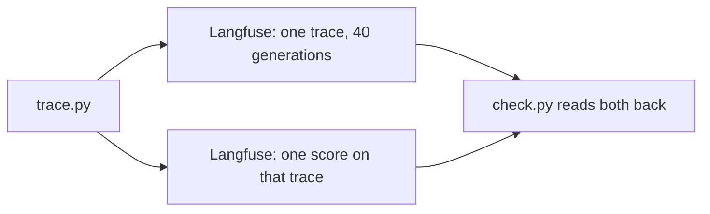

# Trace with Langfuse

## The problem

You traced every run by hand in part 6. A trace store is the same idea as a service: it keeps each run, shows
it on a screen and lets a teammate search it. Langfuse is an open-source trace store that teams host
themselves. Your job is to send one real run of the spray desk to it, with the scorer's number attached.

For example, the dev inbox run makes 40 model calls and scores `correct_share` 0.65. One trace in Langfuse
should show 40 generations and a score of 0.65.

## Your challenge

Work in `assignment/` at the top of the repo, not in this folder. Start the stack from `assignment/compose.yml`,
then finish `assignment/trace.py`. It must wrap the model call, run the finished intake on the dev inbox, and
attach one score to the trace. Name the score for a number the scorer reports, such as `correct_share`. Give it
the scorer's own value for the run.



## Done when

- The Langfuse health endpoint returns 200.
- One trace exists with a model name and token counts.
- The trace has a score named for a number the scorer reports.

```bash
bun run verify trace-with-langfuse
```

Expect: `Done. All 3 rules pass.` when your stack holds a scored trace.

## If you get stuck

- Write secrets once with `uv run python assignment/keys.py`. Never type a key on the command line.
- Traces can take up to a minute to appear. The check waits for them.
- Send the score with `create_score` on the same trace id the run used.
- Run `docker compose --env-file assignment/.env -f assignment/compose.yml logs langfuse-web` if the page
  does not open.

## Words you will use

- **Trace:** the record of one run, made of the steps inside it.
- **Generation:** one model call inside a trace, with its model name and token counts.
- **Score:** a number attached to a trace. Here it is the scorer's `correct_share`.
