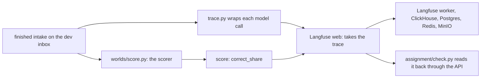

# Do it with the tools teams run

## The problem

In the "Make it safe and visible" part you wrote your own trace log and your own scores. That was the right way to learn what a trace is.
A team that runs an AI system for years does not keep a hand-made log. It sends the same facts to a trace
store: a server that keeps every run so people can search and compare them.

This part redoes that one job with Langfuse, an open-source trace store that teams run themselves. Nothing you
built by hand changes. You add a second way to see the same run.

For example, the dev inbox has 40 emails. The scorer reports `correct_share` 0.65, so 26 emails were booked
right. After this part, Langfuse shows 40 model calls and that same 0.65 on one trace.

## Why it matters

A trace store gives you a screen and a search box over every run. A teammate can open one run and see the
model, the tokens and the score without reading your code. The idea carries over to any tool. You keep the
facts in a standard shape and the tool does the rest.

## What you build



## Steps

| Step                                                            | Minutes | You produce                                    | The check reads                                          |
| --------------------------------------------------------------- | ------- | ---------------------------------------------- | -------------------------------------------------------- |
| [trace-with-langfuse](01-trace-with-langfuse/problem/README.md) | 30      | `assignment/trace.py` and your own trace store | The Langfuse API: a trace with model, tokens and a score |

The part is optional in a live session and expected as homework. The full task, with its Done-when lines and
its rubric, is in [the assignment](../../assignment/README.md).

## Options

Arize Phoenix is the lighter runner-up.

- **Choose when:** your laptop is short on memory. Phoenix is one container. The Langfuse stack is six.
- **Trade-off:** Phoenix uses the Elastic License 2.0. That is source-available, not an open-source licence
  approved by the OSI, and it forbids selling Phoenix as a managed service.

## Walkthrough

You need [Docker](https://docs.docker.com/get-docker/) running. The stack needs about 2 GiB of memory while
idle. Write your own secrets first. The script never prints them:

```bash
uv run python assignment/keys.py
```

Expect: `Wrote 11 secrets to` the path `assignment/.env`, and `Nothing was printed.`

Start your own Langfuse, pinned to release 4.80.0:

```bash
docker compose --env-file assignment/.env -f assignment/compose.yml up -d --wait
```

Expect: six containers reach `Healthy`. The first run downloads the images.

Send one traced run. Use the sample answer, or your own `assignment/trace.py`:

```bash
uv run --group assignment --env-file assignment/.env python parts/09-do-it-with-the-tools-teams-run/01-trace-with-langfuse/solution/trace.py
```

Expect: `Sent trace` with a 32-character id and `40 model calls.`

Open `http://localhost:3000` and look at the trace. The email is `learner@example.com`. The password is the value
of `LANGFUSE_UI_PASSWORD` in `assignment/.env`.

Expect: one trace named `spray desk, dev inbox`, 40 generations with a model name and token counts, and a
score called `correct_share`.

Check your work:

```bash
bun run verify trace-with-langfuse
```

Expect: `Done. All 3 rules pass.` once your stack holds a scored trace.

Stop the stack and delete its data when you finish:

```bash
docker compose --env-file assignment/.env -f assignment/compose.yml down -v
```

Expect: the six containers and three volumes are removed.

## Finished

You have the same run in two places: your hand-built log, and a trace store teams use. The scorer's number is
the same in both. If the two numbers ever disagree, trust the scorer and look for the bug in the wrapper.
