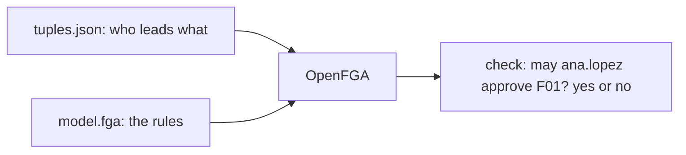

# Check access with OpenFGA

## The problem

Tallgrass Bend sprays fields for farms. Before a spray job runs, a person must approve it. Today the list of
who may approve is typed in by hand. Crews change often. A new field is not on the list, so nobody may
approve it until someone types it in.

For example, Ana leads the North crew. Her crew serves farm G01, which has two fields. A new field on G01
should let Ana approve jobs, with no extra typing.



## Your challenge

Work in the `problem/` folder. Write two files:

- `model.fga` holds the rules. Use types `user`, `crew`, `farm` and `field`.
- `tuples.json` holds the facts. It is a list. Most facts come from `worlds/tallgrass_bend/access.json`.
  Each field's link to its farm comes from `worlds/tallgrass_bend/seed.json`.

The rules are these:

- A crew lead may approve the fields of every farm the crew serves.
- A farm manager may approve every field of that farm.
- The auditor may view a field, and may not approve it.
- Nobody else may do anything.

Each field gets a link to its farm. Access then reaches the field through the farm. Do not copy a grant onto
each field.

Run the check when you are ready:

```bash
bun run verify check-access-with-openfga
```

Expect: `Done. All 3 rules pass.` when your model and tuples are right.

## Done when

- OpenFGA is running and accepts your model
- Every dev request gets the answer the roster gives
- A new field inherits its farm's access with no new grant

## If you get stuck

- Docker must be running. The check starts its own OpenFGA server and stops it when the check ends.
- Read the first FAIL line. Its Try next line says what to change.
- Each `define` line in the model is one relation. For example, `define lead: [user]` names one relation.
- A row in `tuples.json` looks like this: `{"user": "user:ana.lopez", "relation": "lead", "object": "crew:C01"}`.
- Use the auditor's rows from the roster for every farm. The auditor covers all eight farms.
- For a new field, you write only the link from the field to its farm. You write no grant for it.

## Words you will use

- **Tuple:** one fact, such as "Ana leads crew C01".
- **Relation:** a named link between two things, such as `lead` or `can_approve`.
- **Model:** the rules that say how facts give access.
- **Check:** a question with a yes or no answer. For example: may `user:ana.lopez` `can_approve` `field:F01`?
