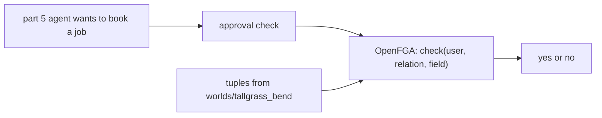

# Check access with OpenFGA

## The problem

In part 5, the "ask before acting" approval uses a hand-written list of who may approve a job. Real crews
change often. A list cannot say "every field of this farm" without copying a row for each field. So a new
field is silently unprotected until someone copies its rows.

For example, Ana leads the North crew. Her crew serves farm G01. A new field on G01 should let Ana approve
jobs at once, with no new row.

## Why it matters

A copied list goes stale when the world changes. A rule that says "a crew lead may approve the fields of
the farms the crew serves" stays true. OpenFGA is a server that stores these facts and answers one
question: may this user do this on this thing? It answers yes or no.

## What you build



The approval check asks OpenFGA the same question each time. The answer comes from the model and the tuples.
The lab uses the Tallgrass Bend roster, so you can test the answers against the truth.

## Steps

| Step                                                                        | Minutes | You produce                   | The check reads                                                      |
| --------------------------------------------------------------------------- | ------- | ----------------------------- | -------------------------------------------------------------------- |
| [check-access-with-openfga](01-check-access-with-openfga/problem/README.md) | 30      | `model.fga` and `tuples.json` | OpenFGA's yes or no answers: the model, 12 dev requests, a new field |

In the step, you write the model first. Then you write the tuples and run the 12 dev requests. Last, you add
a new field under a farm and check that its crew lead may approve it.

## Options

OpenFGA is the pick for this lab. SpiceDB is the runner-up. Both follow Zanzibar, the design Google uses for
access checks. Both are open source under the Apache-2.0 licence.

- **Choose SpiceDB when:** you need very large graphs, caveats, or a managed service.
- **Trade-off:** SpiceDB needs a real database, such as Postgres or CockroachDB, even for a lab. The stack is
  heavier.

The memory datastore in this lab loses every tuple on restart. For example, a restart empties the store, so the
check writes its tuples again. Production uses Postgres or MySQL.

## Walkthrough

You need [Docker](https://docs.docker.com/get-docker/) running. The check starts its own server, so you can
run it without the commands below. The commands show the server by itself.

Run the sample answer through the check:

```bash
bun run verify check-access-with-openfga solution
```

Expect: `Done. All 3 rules pass.`

Run the starter. It fails, because the model is empty:

```bash
bun run verify check-access-with-openfga
```

Expect: `0 of 3 rules pass.` and a Try next line under each FAIL.

Start one OpenFGA server on your computer:

```bash
docker compose -f assignment/openfga/compose.yml up -d --wait
```

Expect: `openfga` with the status `Healthy`.

Check your model and tuples against that server:

```bash
uv run python assignment/openfga/check.py --url http://127.0.0.1:8080
```

Expect: three PASS or FAIL lines, one for each rule in the step.

See how much memory the server uses:

```bash
docker stats --no-stream
```

Expect: one row for the OpenFGA container with a memory figure under the 512 MiB limit.

Stop the server and delete its data when you finish:

```bash
docker compose -f assignment/openfga/compose.yml down -v
```

Expect: the container and its network are removed.

## Finished

You have a model that grants access by relation, not by a copied list. A field added later is covered by its
farm. The auditor can view and cannot approve. The check proves each of these with OpenFGA's own answers.
