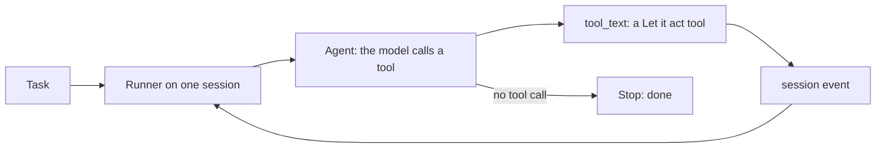

# Run the loop on ADK

## The problem

In the "Let it act" part you wrote the agent loop yourself. It worked, but every line of it is yours to keep. A framework
can run that loop for you. Google's Agent Development Kit (ADK) keeps the session, calls the tools in order,
and writes down every event.

## Your challenge

`agent.py` is the `act` verb. It builds one ADK `Agent`, then runs it with a `Runner` on a session. Right now
the agent has no tools, so it cannot book anything. Your job has three parts:

1. Write four tool functions: `find_grower`, `find_product`, `book_job` and `send_to_review`. Each one calls the
   matching "Let it act" tool through `tool_text()`. The docstring is what the model reads, so say what the tool does.
2. Pass the four functions to `Agent` in `build_agent()`.
3. Keep the check in `book_job`. If `BOOKED` already has the email, return that answer and book nothing new.

`stub_model.py` plays the model. You do not need to change it. It reads the same recorded replies as the "Let it act" part.
After each booking, it drops one reply, as a flaky network can. The agent must retry, so the check in
`book_job` decides whether the retry books twice.

For example, with the world running in another terminal, run the starter on one email:

```bash
uv run world email TB-1001 | uv run --group adk python agent.py
```

Expect: `{"run_id": "...", "stop_reason": "done", "attempts": 1, "tool_calls": 0}`. The model had no tools,
so it made no call, and TB-1001 is not booked.



## Done when

- `contract.toml` names an `act` verb.
- `act` exits 0 on every dev email, 3 fresh runs out of 3.
- `act` prints one line of JSON with a `run_id` and a `stop_reason`.
- Every dev email ends booked or with a person, once each.
- At least 20 of the 40 dev emails end with a booked job.
- The event log in `runs/adk-events.jsonl` shows `find_grower` before every `book_job`.

```bash
bun run verify run-the-loop-on-adk
```

Expect: `Done. All 6 rules pass.` once your agent meets every rule.

## If you get stuck

- A tool error is still an answer. `tool_text()` returns it, so the model can read it and try again.
- Without the check in `book_job`, each retry books the same email again. Look at the duplicates in
  `runs/adk-events.jsonl`.
- If the model has no tools, it answers at once. Check that `tools=[...]` lists your four functions.
- If `import google.adk` fails, run `uv sync --group adk` once.

## Words you will use

- **Agent:** ADK's name for one model with its instructions and its tools.
- **Runner:** the object that runs an agent on a session, one message at a time.
- **Session:** one conversation. Here it is one email, and it holds the event log.
- **Event:** one step in a session: a tool call, a tool's answer, or the model's final answer.

## Rubric

- The agent is one ADK `Agent` with "Let it act" tools.
- Every email ends booked or with a person, once.
- The run leaves an event log a teammate can read.
