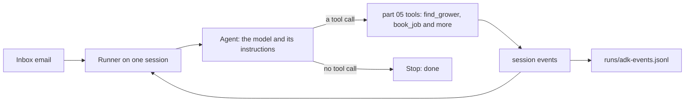

# Run the agent with Google ADK

This part is optional. It is expected as homework, after part 09. Its one step keeps the same spray desk job
as part 05, so you can compare the two loops.

## The problem

In part 05 you wrote the agent loop yourself. The model is asked for a step, the tool runs, the answer goes
back, and the loop repeats. The loop fits in one file. It also means you keep every line of it.

## Why it matters

A framework can run that loop for you. It keeps the session, calls the tools in order, and writes an event log.
A teammate can read that log without reading your code. You learn what the framework does for you by seeing
the same job run both ways.

## What we teach

This part runs the spray desk job in Google's Agent Development Kit (ADK). You write one ADK `Agent` with the
part 05 tools. A `Runner` runs it on an in-memory session. Then you read the events that ADK recorded.

For example, email TB-1001 asks for Podshield on the Old Yard field. The agent finds the grower first, then
books the job. The event log shows `find_grower` before `book_job`.



## Steps

| Step                                                            | Minutes | You produce                                    | The check reads                                                  |
| --------------------------------------------------------------- | ------- | ---------------------------------------------- | ---------------------------------------------------------------- |
| [run-the-loop-on-adk](01-run-the-loop-on-adk/problem/README.md) | 20      | `agent.py` with four tools and one ADK `Agent` | The exit code, the end state in the world, and the ADK event log |

Each step's check is in `checks/`. Its rubric is at the end of the step's README.

## Options

Option A is to keep your own loop. That is the loop you built in part 05. It fits in one file, and you can read
every step of it.

Option B is the ADK step in this part. Use it when you want a framework to own the loop, the session and the
events.

Option C is the OpenAI Agents SDK, the runner-up. It also runs an agent with tools and a session.

- **Choose B when:** you want a framework to own the loop, the session and the events.
- **Trade-off:** a large dependency tree, fast-moving major versions (2.x), and a loop you can no longer read in
  one file.
- **Choose A when:** you want to read every step of the loop in one place.

What this step does not prove:

- A stub model proves the wiring, the tool order and the end states. It does not prove how a real model
  behaves inside ADK, or what a real model costs or how long it takes.
- Whether `LiteLlm` works with the repo's model roles is not checked. This part leaves it out.
- ADK's deployment, evaluation and multi-agent features are not taught here.

## Walkthrough

Start the application system in a second terminal. Leave it running while you work:

```bash
uv run world serve
```

Expect: `The spray desk is open at http://127.0.0.1:8100 (dev inbox). Stop it with Ctrl+C.`

Install the ADK group once. It pins `google-adk` to one exact version:

```bash
uv sync --group adk
```

Expect: uv finishes with no error, and the group's packages are in the project's `.venv`.

Run the agent on one email. Run it in the step's `problem/` folder:

```bash
uv run world email TB-1001 | uv run --group adk python agent.py
```

Expect: `{"run_id": "...", "stop_reason": "done", "attempts": 1, "tool_calls": 0}` for the starter. The sample
answer prints `"attempts": 2` and `"tool_calls": 6`, because the model drops one reply after the booking. The
retry books nothing new.

Read the event log. Each line is one ADK event, with its `run_id`:

```bash
head -3 runs/adk-events.jsonl
```

Expect: three JSON lines, each with a `run_id` and an `author`, such as `"user"` for the email.

Check one step at any time:

```bash
bun run verify run-the-loop-on-adk
```

Expect: `FAIL` lines with `Try next:` until your tools and their check are in place, then `Done. All 6 rules pass.`

Check the whole part:

```bash
bun run verify part run-the-agent-with-google-adk
```

Expect: one line for the step, then `Part run-the-agent-with-google-adk is done: 1/1 steps pass.` once it passes.

## Finished

You ran the same job through a framework. The framework kept the session and the loop. Your own check still
decided what counts as correct: the bookings in the world, not the model's words.
